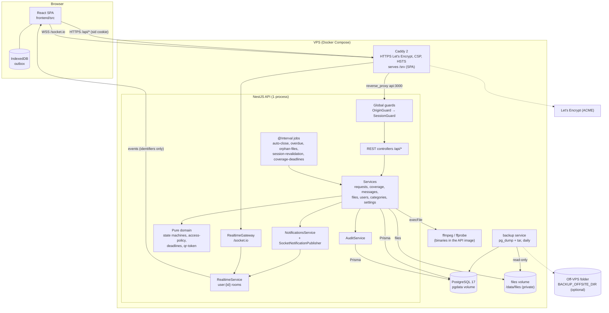
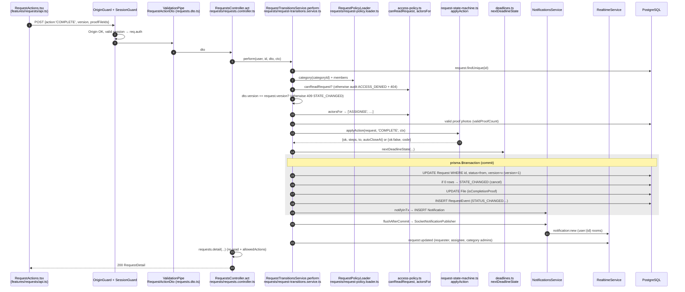
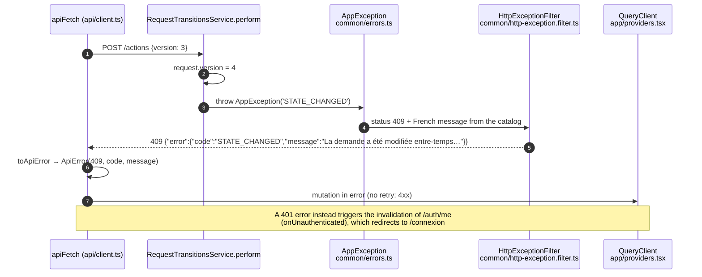

# Architecture — La Joconde Jumelle

> Analysis established on 2026-10-15 from the code of the `002-refonte-ui-destinataires` branch
> (latest commit `595c3fc`). The three changes that were then uncommitted (port 3000 → 3002) were
> committed in `1e6d4ee`.
>
> **Follow-up of the fixes**: the findings were handled by feature 003
> (`specs/003-corrections-audit-technique/`). Each finding that was handled carries the mention "Fixed"
> with its commit; §12 summarizes the state of all the findings (A01 to A35 of specification
> 003, and N1 to N3 noted while it was being carried out). The rest of the document describes the state of commit
> `595c3fc`.
>
> Each statement is marked:
> - **[VERIFIED]**: read in the code or the configuration, or observed by running a command;
> - **[INFERRED]**: assumption or interpretation, not proven by the code.
>
> Paths are relative to the repository root.

---

## 1. Overview

### Type of application

- **[VERIFIED]** The application is a **modular monolith** in two parts:
  - a **React SPA** (frontend);
  - a **single NestJS API**, which serves both REST under `/api` and Socket.IO under `/socket.io`.

  The whole runs in **a single API process**. Sources: `backend/src/app.setup.ts` (`configureApp`, `setGlobalPrefix('api')`) and `backend/src/realtime/realtime.gateway.ts` (`@WebSocketGateway({ path: '/socket.io' })`).
- **[VERIFIED]** It is an npm *workspaces* repository that contains `backend` and `frontend` (`package.json`, `workspaces` field).
- **[VERIFIED]** In production, Caddy serves the SPA as static files and relays `/api/*` and `/socket.io/*` to the API, **on the same domain** (`deploy/Caddyfile`).
- **[VERIFIED]** The application covers two business domains that share the `Request` table (`kind` field):
  - `WORK`: work requests (phase 1);
  - `COVERAGE`: class coverage, that is, duty or substitution (phase 2).

  Sources: `backend/prisma/schema.prisma` (`enum RequestKind`, `model Request.kind`).
- **[VERIFIED]** There are no microservices, no serverless, no message queue, no external cache (Redis is absent from the dependencies). The absence of Redis is accepted in `specs/001-demandes-travail-vocales/plan.md` ("Complexity Tracking").

### Stack

Exact versions read from `package-lock.json`; Node verified with `node -v` on the workstation.

| Layer | Technology | Version | Source |
|---|---|---|---|
| Language | TypeScript (strict) | 5.9.3 | `package.json`, `backend/tsconfig.json` |
| Runtime | Node.js | ≥ 24 required (24.21.0 on the workstation) | `package.json` (`engines`), `.nvmrc` |
| API framework | NestJS (Express) | 11.2.7 | `backend/package.json` |
| Real time | Socket.IO (server and client) | 4.8.4 | `backend/package.json`, `frontend/package.json` |
| ORM | Prisma | 6.19.3 | `backend/package.json`, `backend/prisma/schema.prisma` |
| Database | PostgreSQL 17 | image `postgres:17` in prod; `embedded-postgres` 17.10.0-beta.17 in dev | `deploy/docker-compose.yml`, `backend/scripts/dev-db.ts` |
| Validation | class-validator / class-transformer | 0.15 / 0.5 | `backend/src/common/validation.pipe.ts` |
| Passwords | argon2 (Argon2id) | 0.45.1 | `backend/src/auth/auth.service.ts` |
| Photos | sharp | 0.35.5 | `backend/src/files/photo-processing.ts` |
| Voice messages | ffmpeg / ffprobe (system binaries) | not pinned | `backend/src/files/voice-processing.ts`, `deploy/api.Dockerfile` |
| File upload | Multer | 2.x | `backend/src/files/files.controller.ts` |
| Scheduled tasks | @nestjs/schedule (`@Interval`) | 6.x | `backend/src/scheduler/*.job.ts` |
| Rate limiting | @nestjs/throttler | 6.x | `backend/src/auth/login-throttler.guard.ts` |
| UI | React | 19.3.0 | `frontend/package.json` |
| Frontend build | Vite | 8.3.4 | `frontend/vite.config.ts` |
| Frontend routing | React Router | 7.18.4 | `frontend/src/app/routes.tsx` |
| Server state (frontend) | TanStack Query | 5.104.2 | `frontend/src/app/providers.tsx` |
| Components | MUI (Material UI) + Emotion | 9.5.0 | `frontend/src/app/theme.tsx` |
| Icons | lucide-react | 1.x | `frontend/src/app/providers.tsx` (`LucideProvider`) |
| Local storage (frontend) | idb-keyval (IndexedDB) | 6.x | `frontend/src/features/outbox/outbox.ts` |
| Tests | Jest 30.5.2 + Supertest; Vitest 5.0.4 + Testing Library; Playwright 1.64.0 + axe | — | `package.json` at the three levels |
| Deployment | Docker Compose, Caddy 2 | — | `deploy/` |

---

## 2. Role of each folder and module

### Root

| Folder | Role | Source |
|---|---|---|
| `backend/` | NestJS API, Prisma schema and migrations, operations scripts | [VERIFIED] |
| `frontend/` | React SPA | [VERIFIED] |
| `e2e/` | Playwright end-to-end tests: 12 `*.spec.ts` files, browser profiles, axe checks | [VERIFIED] `e2e/playwright.config.ts` |
| `deploy/` | Dockerfiles, docker-compose (prod and dev), Caddyfile, backup and restore scripts | [VERIFIED] |
| `specs/001-demandes-travail-vocales/` | Specification, plan, research, data model, contracts and tasks of **phase 1** | [VERIFIED] |
| `docs/` | Manual validation (iPhone, usability) and procedure for migration 0002 | [VERIFIED] |
| `.specify/`, `.claude/skills/` | "spec-kit" tooling (templates, constitution, assistant commands); not application code | [VERIFIED] |

- **[VERIFIED]** There is **no `specs/002-…` folder**: phase 2 (class coverage) has no versioned specification. It is documented only by `docs/coverage-migration.md` and by the code comments.

### Backend modules (`backend/src/`)

The "Depends on" and "Used by" columns were established from the actual `import '../<module>/…'` statements (`grep` command on `backend/src`). **[VERIFIED]**

| Module | Role | Depends on | Used by |
|---|---|---|---|
| `config/` | Reads and validates the environment variables at startup (`loadConfig`); loads `backend/.env` outside production (`loadEnvFile`); provides `APP_CONFIG` (global module) | — | auth, coverage, files, realtime, scheduler |
| `common/` | Prisma (`PrismaService`), error catalog (`AppException`, `ERROR_CATALOG`), error filter, validation pipe, JSON logger, cursor pagination, `SuperAdminGuard`, `X-Server-Time` header | audit, auth | almost all |
| `audit/` | Append-only audit log (`AuditService.log`, `sanitizeAuditDetails`); `/api/admin/audit` consultation (super administrator) | common | auth, categories, common, coverage, files, messages, realtime, requests, settings, users |
| `auth/` | Login, logout, password change (`AuthController`, `AuthService`); server sessions (`SessionService`); global guards `OriginGuard` (CSRF) and `SessionGuard`; login attempt limiting | audit, common, config, realtime, requests (`access-policy`), settings | almost all (`AuthenticatedUser` types, `@CurrentUser`, `@Public` decorators) |
| `settings/` | Global settings in the database with default values (`SETTING_DEFAULTS`), permissions by role, administration | audit, auth, common, users | auth, cli, coverage, files, messages, requests |
| `users/` | Account administration (`/api/admin/users`) | audit, auth, common, realtime | categories, settings |
| `categories/` | Categories visible to the user and their administration (workflow, recipients, category admins, deadlines by priority) | audit, auth, common, requests, users | — |
| `requests/` | Work requests. Contains two **pure** modules: `domain/request-state-machine.ts` and `domain/access-policy.ts`, as well as `domain/deadlines.ts` and `domain/visibility.ts`. Added to these are the services `RequestsService` (creation, reading, priority, drafts) and `RequestTransitionsService` (status actions) | audit, auth, common, files, notifications, realtime, settings | auth, categories, coverage, files, messages, scheduler |
| `messages/` | Discussion thread of a request (text, voice, attachments) | audit, auth, common, notifications, realtime, requests, settings | — |
| `files/` | Upload, checking (magic bytes, ffprobe, sharp), private storage on disk (`FileStorageService`) and authenticated reading (`GET /api/files/:id`) | audit, auth, common, config, coverage, requests, settings | requests, scheduler |
| `notifications/` | Writes the notifications in the transaction (`notifyInTx`) then publishes them after commit (`flushAfterCommit` → `SocketNotificationPublisher`); read API | auth, common, realtime | coverage, messages, requests, scheduler |
| `realtime/` | `RealtimeService` (emission to the `user:{id}` and `session:{id}` rooms); `RealtimeGateway` (authentication at the handshake) | audit, auth, config | auth, coverage, messages, notifications, requests, scheduler, users |
| `scheduler/` | Periodic tasks: automatic closing, delays, revalidation of WebSocket sessions, orphan files | common, config, files, notifications, realtime, requests | coverage (`JOB_INTERVAL_MS` constant) |
| `coverage/` | Phase 2: class coverage, with its own state machine (`domain/coverage-state-machine.ts`), its access policy (`domain/coverage-policy.ts`), the signed QR token (`domain/qr-token.ts`), employee availability, groups, classes, and its own deadlines task (`coverage-deadlines.job.ts`) | audit, auth, common, config, notifications, realtime, requests, scheduler, settings | files |
| `health/` | `GET /api/health`, public, used by the Docker `HEALTHCHECK` | auth (`@Public`) | Docker |
| `cli/` | `bootstrap.ts`: creation of the first super administrator in production | settings | operations |

> **Updated (feature 003)**: `SuperAdminGuard` is now in `audit/`;
> `request-info` and the cross-cutting rules (`authorization.ts`) are in `common/`; `files/` no longer
> depends on `requests/` or `coverage/` (access registry); the coverage deadlines job
> is in `scheduler/`. The columns above describe the state of commit `595c3fc`.
>
> **Updated (feature 004)**: `coverage/` becomes the **supervisor assignments**
> module (section 13); `scheduler/` adds `coverage-reminders.job.ts` (due dates,
> unfilled) and `coverage-anonymization.job.ts`; the computation of system-key groups is in
> `common/group-flags.ts` (used by `auth/` and `coverage/`).

Scripts and data outside `src/`:

| Folder | Role |
|---|---|
| `backend/prisma/` | `schema.prisma`, migrations `0001_init` to `0009_supervision_data` (with `down.sql`; `0008`/`0009`: feature 004), `seed.ts` (demo data), `seed-volume.ts` (test volume) |
| `backend/scripts/` | Embedded dev database (`dev-db.ts`), e2e server, fixture generation, and three one-off maintenance scripts: `repair-employee-recipients.ts`, `check-users.ts`, `reset-superadmin-password.ts` (deleted: `bootstrap.js --reset-password` subcommand, commit `5ed613d`) |
| `backend/test/` | 15 unit test files, 24 integration test files (real PostgreSQL database), audio, image and PDF fixtures |

### Frontend modules (`frontend/src/`)

| Folder | Role | Depends on | Used by |
|---|---|---|---|
| `api/` | `client.ts` (`apiFetch`, `ApiError`, `serverNow`), shared types **written by hand** (`types.ts`), settings, uploads | — | all features |
| `app/` | Assembly point: providers (`QueryClient`, theme, toasts), routes, `AppLayout` (mounts `SocketProvider`), MUI theme | api, components, design, features | `main.tsx` |
| `components/` | Generic components: badges, empty, error and loading states, dialogs, countdowns | design | features |
| `design/` | Design tokens (`tokens.ts`) | — | app, components |
| `features/auth` | Login, password change, `RequireAuth`, `useCurrentUser` | api | app, other features |
| `features/requests` | List, creation, detail, actions, filters and history of work requests | api, thread, voice, outbox | app |
| `features/thread` | Discussion thread and attachments | api, voice, outbox | requests |
| `features/voice` | Recording and playback of voice messages (MediaRecorder) | api | requests, thread |
| `features/outbox` | Local outbox (IndexedDB) of failed uploads | idb-keyval | requests, thread |
| `features/notifications` | `SocketProvider` (Socket.IO → TanStack Query cache invalidation), notification center | api, requests, thread | app |
| `features/coverage` | Phase 2 screens: duties, creation, attendance (QR and photo), dashboard, administration of classes and groups | api | app |
| `features/admin` | Administration: accounts, categories, settings, audit log | api | app |

- **[VERIFIED]** The count of imports between `features/` folders was obtained with `grep`.
- **[INFERRED]** The exact direction of each arrow was not checked file by file.

---

## 3. Overall architecture diagram

**[VERIFIED]** Sources: `deploy/docker-compose.yml`, `deploy/Caddyfile`, `backend/src/app.module.ts`, `frontend/vite.config.ts`.



Points verified in the code:

- **[VERIFIED]** The API and the database **publish no port** (`expose` only, `deploy/docker-compose.yml`). Only Caddy listens on 80 and 443.
- **[VERIFIED]** The Socket.IO events carry only identifiers and metadata. The client reads the data again through REST (comment in `RealtimeService`; `SocketProvider` calls `invalidateQueries`).
- **[VERIFIED]** No third-party API is called by the application. The only external services are Let's Encrypt, via Caddy, and the optional remote backup folder.

---

## 4. Journey of a request, end to end

### 4.1 Login (`POST /api/auth/login`)

```mermaid
sequenceDiagram
  autonumber
  actor U as User
  participant LP as LoginPage.tsx<br/>(useLogin, useCurrentUser.ts)
  participant AF as apiFetch<br/>api/client.ts
  participant C as Caddy<br/>deploy/Caddyfile
  participant OG as OriginGuard<br/>auth/origin.guard.ts
  participant SG as SessionGuard<br/>auth/session.guard.ts
  participant TG as LoginThrottlerGuard<br/>auth/login-throttler.guard.ts
  participant VP as ValidationPipe<br/>common/validation.pipe.ts
  participant AC as AuthController.login<br/>auth/auth.controller.ts
  participant AS as AuthService.login<br/>auth/auth.service.ts
  participant SS as SessionService.create<br/>auth/session.service.ts
  participant AU as AuditService.log<br/>audit/audit.service.ts
  participant DB as PostgreSQL

  U->>LP: username + password
  LP->>AF: POST /api/auth/login {username, password}
  AF->>C: fetch (credentials: same-origin)
  C->>OG: reverse_proxy
  OG->>OG: Origin header = APP_ORIGIN?
  OG->>SG: OK
  SG->>SG: @Public() route → lets through
  SG->>TG: 
  TG->>TG: ≤ N attempts / min per (IP, username)
  TG->>VP: 
  VP->>VP: LoginDto (whitelist, lengths)
  VP->>AC: valid dto
  AC->>AS: login(username, password, ip)
  AS->>DB: user.findUnique(normalized username)
  AS->>AS: argon2.verify (dummy hash if account unknown)
  alt failure
    AS->>AU: LOGIN_FAILURE (reason)
    AU->>DB: INSERT AuditLog
    AS-->>AC: AppException INVALID_CREDENTIALS (401)
  else success
    AS->>SS: create(userId, ip)
    SS->>SS: 256-bit token; id = HMAC-SHA256(token)
    SS->>DB: INSERT Session (expiresAt = sessionMaxHours)
    AS->>AU: LOGIN_SUCCESS
    AU->>DB: INSERT AuditLog
    AS->>DB: rolePermission.findMany (role permissions)
    AC-->>AF: 200 {user} + Set-Cookie sid (HttpOnly, SameSite=Strict, Secure*)
  end
  AF-->>LP: Me
  LP->>LP: navigate('/mot-de-passe' if mustChangePassword, otherwise requested page)
```

- **[VERIFIED]** The order of the global guards (Origin, then Session) is set in `auth/auth.module.ts` (`APP_GUARD`, with the comment "Ordre des gardes globales", i.e. order of the global guards).
- **[INFERRED]** Route guards, such as `LoginThrottlerGuard`, run after the global guards. This is standard NestJS behavior; I did not trace it at runtime.
- **[VERIFIED]** `Secure` is forced in production; in dev, it depends on `COOKIE_SECURE` (`config/config.ts`, `cookieSecure`).

### 4.2 Database write: action on a request (`POST /api/requests/:id/actions`)

Example: the assigned employee moves the request to "Terminée" (Completed) (`COMPLETE`).



- **[VERIFIED]** All these steps appear in `RequestTransitionsService.perform` and `commit` (`requests/request-transitions.service.ts`) and in `RequestsController.act`.
- **[VERIFIED]** Notifications are emitted only **after** the transaction (`notifications.service.ts`, comment of `flushAfterCommit`).

### 4.3 Error case: version conflict and single error format



(The message "La demande a été modifiée entre-temps…" means "The request was modified in the meantime…".)

- **[VERIFIED]** `HttpExceptionFilter` turns every exception into `{ error: { code, message, details? } }`. An unknown error is logged, then masked as `INTERNAL_ERROR` (500).
- **[VERIFIED]** The frontend does not retry 4xx errors (`shouldRetry` in `app/providers.tsx`).
- **[INFERRED]** The exact display of the conflict on screen ("la demande a été rechargée", i.e. the request was reloaded) depends on each component; I did not follow it in `RequestActions.tsx`.

Another error case verified in the code: a modifying request without a correct `Origin` header goes through `OriginGuard.canActivate`, which writes `ACCESS_DENIED / ORIGIN_MISMATCH` to the audit log and returns 403 `FORBIDDEN`. **[VERIFIED]**

---

## 5. Data model

**[VERIFIED]** Source: `backend/prisma/schema.prisma`. For readability, the diagram shows only the main fields.

```mermaid
erDiagram
  User ||--o{ Session : "has"
  User ||--o{ CategoryRecipient : "recipient of"
  User ||--o{ CategoryManager : "admin of"
  User ||--o{ Request : "requester (requesterId)"
  User ||--o{ Request : "assignee (assigneeId)"
  User ||--o{ Message : "author"
  User ||--o{ File : "uploader"
  User ||--o{ Notification : "receives"
  User ||--o{ AuditLog : "actor"
  User ||--o{ RequestEvent : "actor"
  User ||--o{ EmployeeGroupMember : "member"
  User ||--o{ CoveragePresence : "confirms"
  Category ||--o{ CategoryRecipient : ""
  Category ||--o{ CategoryManager : ""
  Category ||--o{ DeadlineRule : "deadlines by priority"
  Category ||--o{ Request : "classifies"
  Category }o--o| User : "autoAssignee"
  Request ||--o{ Message : "thread"
  Request ||--o{ File : "files"
  Request |o--o| File : "voiceFile"
  Request ||--o{ RequestEvent : "history (append-only)"
  Request ||--o{ Notification : ""
  Request ||--o| CoverageDetail : "if kind=COVERAGE"
  Message ||--o{ File : "attachments"
  Message |o--o| File : "voiceFile"
  SchoolClass ||--o{ CoverageDetail : ""
  EmployeeGroup ||--o{ EmployeeGroupMember : ""
  Request ||--o{ CoveragePresence : ""
  CoveragePresence |o--o| File : "attendance photo"

  User { uuid id PK; string username UK; Role role; string passwordHash; bool mustChangePassword; bool active; Availability availability }
  Session { string id PK "HMAC of the token"; uuid userId FK; datetime lastSeenAt; datetime expiresAt }
  RolePermission { Role role PK; Permission permission PK }
  Category { uuid id PK; string name UK; RequestKind kind; Circuit circuit; ClosureMode closureMode; bool finalValidation; AssignmentMode assignmentMode; bool photoRequired; ProofMode proofMode }
  DeadlineRule { uuid id PK; uuid categoryId FK; Priority priority; int validationMinutes; int takeoverMinutes; int completionMinutes; int arrivalMinutes }
  Setting { string key PK; json value }
  Request { uuid id PK; RequestKind kind; int number UK; string reference UK; uuid clientId; RequestStatus status; int version; json rulesSnapshot; Priority priority; DeadlineStage currentStage; datetime currentDueAt; datetime autoCloseAt }
  Message { uuid id PK; uuid requestId FK; MessageKind kind; string text; uuid clientId }
  File { uuid id PK; FileKind kind; string mimeType; string storagePath; bool isCompletionProof }
  RequestEvent { uuid id PK; uuid requestId FK; RequestEventType type; json fromValue; json toValue }
  AuditLog { uuid id PK; AuditAction action; uuid actorId; json details; string ip }
  Notification { uuid id PK; uuid userId FK; NotificationType type; uuid requestId FK; datetime readAt }
  SchoolClass { uuid id PK; string name UK; int qrVersion }
  EmployeeGroup { uuid id PK; string name UK }
  EmployeeGroupMember { uuid groupId PK; uuid userId PK }
  CoverageDetail { uuid requestId PK; uuid classId FK; datetime startAt; datetime plannedEndAt; uuid reliefForId }
  CoveragePresence { uuid id PK; uuid requestId FK; PresenceMethod method; uuid fileId }
```

Key points:

- **[VERIFIED]** `Request.rulesSnapshot` (JSON) copies the category rules when the request is created (`RequestPolicyLoader.rulesSnapshot`). A later change to the category therefore does not affect requests in progress.
- **[VERIFIED]** `Request.version` is used for optimistic locking (`updateMany … where version`).
- **[VERIFIED]** The pair `(requesterId, clientId)` is unique, as is `(authorId, clientId)` on `Message`. This makes resubmissions from the outbox idempotent (`RequestsService.create`, handling of the `P2002` error).
- **[VERIFIED]** `AuditLog` and `RequestEvent` are protected by **PostgreSQL triggers** that refuse `UPDATE`, `DELETE` and `TRUNCATE` (`backend/prisma/migrations/0001_init/migration.sql`, `forbid_modification` function).
- **[VERIFIED]** `RequestStatus` is a single enum that mixes the phase 1 and phase 2 statuses (`BROADCAST`, `ON_DUTY`, etc.). It is the code (`isCoverageStatus`, `kind`) that separates them, not the database.

### Migrations

- **[VERIFIED]** Migrations are managed by Prisma Migrate, in `backend/prisma/migrations/`:
  - `0001_init`: initial schema and append-only triggers;
  - `0002_coverage`: phase 2, additive migration, accompanied by a manual `down.sql`;
  - `0003_request_event_seq` (feature 003, finding N3): `RequestEvent.seq` column, write order of the history events.
- **[VERIFIED]** In dev: `npm run -w backend prisma:migrate` (`prisma migrate dev`).
- **[VERIFIED]** In prod: `prisma migrate deploy` is run **at every container start** (`deploy/api-entrypoint.sh`).
  → **Fixed** (`4575b84`): a pending migration is applied only if a recent backup exists; `deploy/deploy.sh` produces it.
- **[VERIFIED]** The backup and rollback procedure for phase 2 is described in `docs/coverage-migration.md`.

---

## 6. Technical choices and justifications

**Origin of the choices.** `specs/001-demandes-travail-vocales/research.md` (line 5) states: "La pile technique a été imposée par le client." (the technical stack was imposed by the client). **[VERIFIED]** (the text is present in the repository).

I cannot verify **which specific items** were in your initial request: the original message is not versioned, and the spec cites only the functional description. The "Origin" column below therefore reproduces what the repository documents say. **To be confirmed by you.**

| Choice | Why (according to the repository) | Alternatives rejected (according to `research.md`) | Trade-off | Origin |
|---|---|---|---|---|
| React SPA + NestJS API **on the same domain** | Simple session cookies, no CORS, `<audio src="/api/files/…">` authenticated by cookie (R1) | Next.js (SSR pointless without SEO); two domains (CORS, cross-domain cookies) | + simplicity, security; − the API and the SPA must be behind the same proxy | "imposed stack" (R1, R12) [VERIFIED in the text] |
| PostgreSQL 17 + Prisma | Relational data, append-only triggers, transactions (R6, R5) | Not detailed for the database | + generated typing, versioned migrations; − complex queries less natural in Prisma (the lists use `visibleRequestsWhere`) [INFERRED] | "imposed stack" [VERIFIED in the text] |
| Server sessions in the database + `HttpOnly`, `SameSite=Strict` cookie; Argon2id | Immediate revocation, same authentication for REST and WebSocket, nothing sensitive in the browser (R7) | JWT in local storage (theft by XSS, hard to revoke); school SSO (not requested) | + revocable, simple; − one database read per request (`SessionService.validate`), mitigated by a `lastSeenAt` refreshed at most once a minute [VERIFIED] | Decided in the plan (R7) [VERIFIED]; explicit request: **unknown** |
| Authorization by pure functions (`access-policy.ts`) | A single policy tested by a table of cases, applied to REST, files and sockets (R8) | CASL (superfluous for 3 roles) | + testable without a database; − a **separate** policy had to be written for phase 2 (`coverage-policy.ts`) | Decided in the plan; the plan's "imposed constraint no. 4" requires the state machine and rights to be tested first [VERIFIED] |
| Home-grown state machine (`request-state-machine.ts`) + optimistic locking | Single source of truth, testable; handles two simultaneous actions (R5) | XState (unnecessary for ~20 transitions); `SELECT … FOR UPDATE` (longer lock) | + readable, tested; − a second, separate machine for phase 2 (`coverage-state-machine.ts`) | Decided in the plan [VERIFIED] |
| Socket.IO, with events containing **identifiers only** | No second access-control path; notifications are persisted, so nothing is lost offline (R9) | Broadcasting the full data; SSE ("imposed stack: Socket.IO") | + safe; − one REST round trip after each event | Socket.IO: "imposed stack" [VERIFIED in the text] |
| TanStack Query as the only server-state manager on the frontend; no Redux or Zustand | Cache, invalidation by real-time event | Not documented | + little state code; − local state is scattered across `useState` calls and two contexts (`ToastContext`, `RealtimeContext`) [VERIFIED] | Listed in the plan; explicit request: **unknown** |
| MUI + Emotion | Accessible components | Not documented | − requires `style-src 'unsafe-inline'` in the CSP (comment in `deploy/Caddyfile`) [VERIFIED] | Listed in the plan; explicit request: **unknown** |
| ffmpeg: conversion of all voice messages to AAC/MP4 | Safari records in MP4/AAC, Chrome and Firefox in WebM or Ogg; cross playback is not guaranteed (plan, "Complexity Tracking") | Keeping the original format | + playback everywhere; − dependency on a system binary, synchronous conversion in the API process [INFERRED: not measured] | Decided in the plan [VERIFIED] |
| sharp | Removal of EXIF/GPS metadata (GDPR) | Keeping photos as they are | + privacy; − native dependency | Decided in the plan [VERIFIED] |
| `@Interval` jobs in the API process, without Redis or a message queue | A single process is enough at the scale of one school (plan) | Redis ("to be reassessed if several instances") | + simple; − **running several API instances is forbidden** without rework (throttler, Socket.IO and jobs are in memory) | Decided in the plan [VERIFIED] |
| embedded-postgres in dev | The workstation had neither Docker nor PostgreSQL (plan, added on 2026-10-12) | Requiring Docker Desktop | + starts without Docker; − beta version (`17.10.0-beta.17`) [VERIFIED] | Decided during implementation [VERIFIED] |
| Docker Compose + Caddy on a single VPS | Imposed stack, a single machine, simple restore (R12) | Kubernetes, object storage, managed database | + low cost and operations; − no high availability | "imposed stack" [VERIFIED in the text] |

---

## 7. Patterns and conventions

### Patterns applied

| Pattern | Where | Status |
|---|---|---|
| **Layered architecture**: controller → service → pure domain → Prisma | `requests/` (controller → `RequestsService` / `RequestTransitionsService` → `domain/*` → `PrismaService`); same structure in `coverage/` | [VERIFIED] |
| **Pure domain, with no dependency on the database** ("functional core, imperative shell") | `requests/domain/*.ts`, `coverage/domain/*.ts`: import only Prisma types | [VERIFIED] |
| **Dependency injection** (NestJS container) | All services; `APP_CONFIG` and `NOTIFICATION_PUBLISHER` tokens | [VERIFIED] |
| **Strategy / port-adapter** for notification publishing | `NotificationPublisher` interface, `SocketNotificationPublisher` implementation (`notifications.module.ts`) | [VERIFIED] |
| **Write, then publish after commit** (close to the "outbox" pattern) | `notifyInTx` then `flushAfterCommit` | [VERIFIED] |
| **Optimistic locking** | `updateMany({ where: { id, status, version } })` in `RequestTransitionsService.commit` and `RequestsService.changePriority` | [VERIFIED] |
| **Idempotence by `clientId`** | `RequestsService.create`, Prisma unique constraints | [VERIFIED] |
| **Secure by default** (closed by default) | global `SessionGuard` + `@Public()` decorator | [VERIFIED] |
| **Centralized error catalog** | `common/errors.ts` (`ERROR_CATALOG`) + `HttpExceptionFilter` | [VERIFIED] |
| **Organization by feature** ("feature folders") on the frontend | `frontend/src/features/*` (each with its own `api.ts` of TanStack Query hooks) | [VERIFIED] |
| **No Repository pattern**: services call Prisma directly | all `*.service.ts` | [VERIFIED] |
| DTO → response mappers | `requests.mapper.ts`, `messages.mapper.ts`, `coverage.mapper.ts` | [VERIFIED] |

### Inconsistencies found

1. **[VERIFIED]** **Automatic assignment outside the snapshot.** `assignmentMode` is copied into `rulesSnapshot` (`request-policy.loader.ts`), but `RequestTransitionsService.assigneeContext` reads `category.assignmentMode` and `category.autoAssigneeId`, that is, the **current** category, on an `APPROVE`. This contradicts the snapshot principle (FR-022).
   **[INFERRED]** If the administrator changes the assignment mode between submission and approval, the new rule applies.
   → **[VERIFIED] Confirmed**, then **fixed** (`3b291ee`): the test `auto-assignment-snapshot.spec.ts`, written before the fix (`0f2e97d`), assigned the request to the newly designated person. The mode and the person are now frozen at submission (decision D1), with two exceptions: earlier request (EXC-1) and unavailable person (EXC-2).
2. **[VERIFIED]** **`RequestPolicyLoader` declared in 5 modules** (`requests`, `categories`, `messages`, `files`, `coverage`) instead of being exported once. NestJS therefore creates one instance per module. The service is stateless, so the impact is **[INFERRED]** low; it is mostly a duplicated declaration.
   → **Fixed** (`55a170e`): `RequestPolicyModule` declares it once.
3. **[VERIFIED]** **Phase 2 deadlines job stored outside `scheduler/`** (`coverage/coverage-deadlines.job.ts`), although it imports `JOB_INTERVAL_MS` from `scheduler/auto-close.job.ts`.
   → **Fixed** (`5e23677`): `scheduler/coverage-deadlines.job.ts`, `JOB_INTERVAL_MS` in `scheduler/job-interval.ts`.
4. **[VERIFIED]** **Outdated comment** in `notifications/notifications.service.ts`: "Implémentation sans effet en Phase 2 ; remplacée par Socket.IO en US4" (implementation with no effect in Phase 2; replaced by Socket.IO in US4). `NoopNotificationPublisher` is exported but used nowhere, neither in `src` nor in `test` (`grep`).
   → **Fixed** (`6549908`): class and comment removed.
5. **[VERIFIED]** **Frontend types written by hand.** `frontend/src/api/types.ts` announces their replacement by generated types (`api:types` → `src/api/schema.d.ts`), but `schema.d.ts` does not exist and is imported nowhere. The enums (`RequestStatus`, etc.) are therefore duplicated between the backend and the frontend.
   → **Fixed**: announcement removed (`6549908`); the enumerations remain hand-written, but `frontend/tests/api/enums-sync.test.ts` (`0e9e213`) compares them with the Prisma schema and fails if they differ.
6. **[VERIFIED]** **Unused dependency**: `@mui/icons-material` is declared in `frontend/package.json`, but no file in `frontend/src` imports it. The icons come from `lucide-react` (49 files).
   → **Fixed** (`6549908`): dependency uninstalled.
7. **[VERIFIED]** **Non-uniform style**: `backend/scripts/check-users.ts` and `reset-superadmin-password.ts` use double quotes, whereas `.prettierrc` requires `singleQuote: true`.
   → **Fixed**: `check-users.ts` formatted (`6549908`); `reset-superadmin-password.ts` deleted (`5ed613d`).
8. **[VERIFIED]** **Inconsistent port**, see §9: 3002 in `main.ts`, `config.ts`, `vite.config.ts` and `start.bat`; 3000 in `backend/.env.example`, the README, `deploy/Caddyfile.dev`, `api.Dockerfile`, `docker-compose.yml` and the `config.spec.ts` test.
   → **Fixed** (`1ae6219`, `c5c6198`): 3002 everywhere in development, verified by `dev-port-consistency.spec.ts`; production explicitly sets 3000 (`api.Dockerfile`).
9. **[VERIFIED]** **Root `dev` script.** `npm run dev` runs `npm run -w backend start` (`node dist/main.js`), therefore **the already compiled build**: no reload, and `build` must have been run beforehand. The README, for its part, recommends `start:dev`.
   → **Fixed** (`c5c6198`): `dev:backend` runs `start:dev`.

---

## 8. Cross-cutting concerns

### Configuration and environment variables

- **[VERIFIED]** The variables are validated at startup by `loadConfig` (`backend/src/config/config.ts`):
  - required: `DATABASE_URL`, `SESSION_SECRET` (≥ 32 characters), `FILES_DIR`, `APP_ORIGIN` (valid URL);
  - optional: `PORT`, `FFMPEG_PATH`, `FFPROBE_PATH`, `COOKIE_SECURE`, `LOGIN_RATE_LIMIT` (ignored in production), `JOBS_ENABLED`, `NODE_ENV`.

  The API refuses to start if a required variable is invalid (`ConfigError`).
- **[VERIFIED]** `TRUST_PROXY` is read **directly** in `app.setup.ts` (`process.env.TRUST_PROXY`), without going through `loadConfig`. `PORT` is also read again directly in `main.ts`.
  → **Fixed** (`5ed613d`): `TRUST_PROXY` is validated by `loadConfig`; `app.setup.ts` and `main.ts` read `APP_CONFIG`.
- **[VERIFIED]** `backend/.env` is loaded only outside production (`loadEnvFile`) and does not overwrite variables that are already defined. `.env` is ignored by git (`.gitignore`, verified with `git check-ignore`).
- **[VERIFIED]** The **business** settings (voice message size, deadlines, session duration…) are in the database (`Setting`). The default values are in `SETTING_DEFAULTS` and the bounds in `SETTING_RULES` (`settings/settings.service.ts`).
- **[VERIFIED]** In production, the variables come from `deploy/.env` via `docker-compose.yml`, which uses the `${VAR:?…}` syntax to block startup if a secret is missing.

### Authentication and authorization

- **[VERIFIED]** **Authentication**:
  - username and password, Argon2id;
  - constant-time comparison against a dummy hash if the account is unknown (`DUMMY_HASH_PROMISE`, `auth.service.ts`);
  - server session: only the HMAC of the token is stored;
  - expiry after inactivity (`sessionIdleMinutes`, 60 by default) and a maximum duration (`sessionMaxHours`, 12);
  - temporary password that must be changed (`mustChangePassword`, checked in `SessionGuard`);
  - at least 12 characters for a new password (`ChangePasswordDto`).
- **[VERIFIED]** **CSRF**: `OriginGuard` on all methods other than GET, HEAD and OPTIONS, in addition to `SameSite=Strict`.
- **[VERIFIED]** **Rate limiting**: 5 attempts per minute per (IP, username) pair, only on `/auth/login` (`LoginThrottlerGuard`). In-memory storage, the `@nestjs/throttler` default.
- **[VERIFIED]** **WebSocket**: same checks (Origin, cookie, `mustChangePassword`) in `RealtimeGateway.authenticate`. Expired sessions are closed every 60 s (`SessionRevalidationJob` → `RealtimeService.revalidateSessions`).
- **[VERIFIED]** **Authorization**, on three levels:
  1. the global role: `/admin/*` is reserved for the super administrator by `SuperAdminGuard`, except the
     reference data (floors, levels, classes and their QR codes, students) and the read-only employee list
     (`/admin/employees`), open to active admins too by `AdministrationGuard` (feature 011,
     `canUseAdministrationSpace`; route list in `test/integration/admin-routes-access.spec.ts`);
  2. the permissions configurable per role (`RolePermission`, defaults in `settings/default-permissions.ts`);
  3. the relationship with the request: `actorsFor` → `REQUESTER`, `ASSIGNEE` or `MANAGER`.

  A resource that is not visible gives a 404 with an `ACCESS_DENIED` audit entry.

### Error handling and logs

- **[VERIFIED]** Errors have a single format `{ error: { code, message, details } }` (`HttpExceptionFilter`). The messages are in French, in `ERROR_CATALOG`. Validation errors return the list of fields (`createValidationPipe`, `flatten`).
- **[VERIFIED]** Logs are output as JSON, one line per entry, on stdout and stderr (`AppLogger`, `common/app-logger.ts`). Secrets are masked by patterns (argon2, cookie, token, password…). **No HTTP request is logged** (class comment; no log middleware in `configureApp`). Since `5ed613d`, logs and audit share the same list of sensitive keys (`common/sensitive-keys.ts`).
- **[VERIFIED]** The audit log filters the `details` fields by whitelist and removes sensitive keys (`sanitizeAuditDetails`).
- **[VERIFIED]** On the frontend, `ApiError` carries the status and the code. A 401 error invalidates `/auth/me`, which redirects to the login (`createQueryClient`).
- **[INFERRED]** There is neither an error tracking tool (Sentry or equivalent) nor metrics: no dependency of this kind appears in the `package.json` files.

### External integrations

- **[VERIFIED]** **No third-party API** is called by the application code (no outgoing HTTP client in `backend/src`). No email, no push notifications (plan constraint).
- **[VERIFIED]** The external runtime dependencies are:
  - the `ffmpeg` and `ffprobe` binaries, called by `execFile` (`files/voice-processing.ts`);
  - Let's Encrypt, via Caddy (`deploy/Caddyfile`);
  - the npm registry and Docker Hub, at build time.

---

## 9. Deployment and execution

### Locally

**[VERIFIED]** Commands read from the README, the `package.json` files and `start.bat`:

```bash
npm install
cp backend/.env.example backend/.env      # fill in SESSION_SECRET
npm run -w backend db:dev                 # embedded PostgreSQL, port 5433 (dedicated terminal)
npm run -w backend prisma:migrate
npm run -w backend prisma:seed   # refused unless DATABASE_URL is on this machine and NODE_ENV is not production
npm run -w backend start:dev              # API with reload
npm run -w frontend dev                   # Vite on :5173, /api and /socket.io proxy
```

- **[VERIFIED]** `start.bat` (committed since in `1e6d4ee`) automates these steps on Windows:
  1. it starts the embedded database if port 5433 is free;
  2. it refuses to continue if port 3002 is already in use;
  3. it runs `npm run dev`, which requires an **already compiled** backend (see §7, item 9). → **Fixed** (`c5c6198`): `npm run dev` now runs the API with reload.
- **[VERIFIED]** **API port in development**: the uncommitted changes move the default value from 3000 to **3002** in `main.ts`, `config.ts`, `vite.config.ts` and `frontend/package.json`. But:
  - `backend/.env.example` still contains `PORT=3000`, which puts the API back on 3000 for anyone who copies the example, whereas Vite looks for 3002;
  - `deploy/Caddyfile.dev` relays to `host.docker.internal:3000`.

  → **Fixed** (`c5c6198`): `PORT=3002` in `backend/.env.example`, `Caddyfile.dev` to 3002, README updated.
- **[VERIFIED]** **The test `backend/test/unit/config.spec.ts` fails** (expected 3000, received 3002). Result as run: 348 tests pass out of 349. → **Fixed** (`1ae6219`).

### Build

- **[VERIFIED]** Backend: `npm run -w backend build` (`nest build` → `backend/dist`).
- **[VERIFIED]** Frontend: `npm run -w frontend build` (`tsc -b && vite build` → `frontend/dist`).
- **[VERIFIED]** Full check: `npm run verify` (lint, unit and integration tests, `npm audit --audit-level=high`). E2E: `npm run test:e2e`.

### Deployment (VPS)

**[VERIFIED]** Sources: `deploy/docker-compose.yml`, `api.Dockerfile`, `web.Dockerfile`, `api-entrypoint.sh`, `deploy.sh`.

```bash
cp deploy/.env.example deploy/.env
deploy/deploy.sh
docker compose -f deploy/docker-compose.yml --env-file deploy/.env exec api node dist/cli/bootstrap.js admin "Direction"
```

`deploy/deploy.sh` updates the code (`git pull --ff-only`), backs up the database and files, then rebuilds and restarts the containers. `deploy/deploy.sh --no-pull` deploys the code already on the server, such as a specific commit. The backup step dates from `4575b84`.

- **[VERIFIED]** Four services:
  - `caddy`: image built with the SPA;
  - `api`: Node 24 + ffmpeg, non-root `node` user, `HEALTHCHECK` on `/api/health`, migrations applied at startup;
  - `db`: `postgres:17`;
  - `backup`: daily loop, `pg_dump` + `tar`, 14-day rotation, copy off the VPS only if `BACKUP_OFFSITE_DIR` is set.
- **[VERIFIED]** Swagger (`/api/docs`) is exposed only outside production (`configureApp`).
- **[VERIFIED]** There was **no CI/CD** in the repository (no `.github/` folder or equivalent in the tree).
  → **Fixed** (`b9ed428`): `.github/workflows/ci.yml` reruns lint, types, unit, integration and interface tests and `npm audit` on every push and pull request (decision D3). Because the repository is private on the free plan, merging is not technically blocked: a manual check is mandatory before merging (`docs/procedure-fusion.md`, decision D10, `7c2af4f`).
- **[INFERRED]** Deployments are therefore manual, and they stay that way: `deploy/deploy.sh` is run by hand on the server.

---

## 10. Architecture weaknesses

### Coupling and circular dependencies

- **[VERIFIED]** There are **import cycles between folders** (found with `grep`):
  - `requests ↔ files`: `requests.module` imports `FilesModule`, and `files.service` imports `requests/domain/access-policy` and `RequestPolicyLoader`;
  - `auth ↔ requests`: `session.service` imports `permissionsFor` from `requests/domain/access-policy`;
  - `common ↔ audit`, `common ↔ auth`: `SuperAdminGuard`, placed in `common/`, depends on `AuditService` and `auth/request-info`.

  A NestJS module cycle had to be worked around explicitly: `RealtimeGatewayModule` exists "pour éviter une dépendance circulaire avec AuthModule" (to avoid a circular dependency with AuthModule) (comment in `realtime/realtime-gateway.module.ts`).

  → **Fixed** for the domains cited (`e533726`, `e05ae30`, `688100e`, `5d573a1`, `5e23677`). Layer order enforced: `config → common → audit → auth → files → requests → coverage → scheduler`; a folder depends only on the folders placed before it. The test `backend/test/unit/architecture-layers.spec.ts` (`0e9e213`) verifies it and names each offending import; it was red on 11 imports at the start, it is green. The separation of `RealtimeGatewayModule` is kept as an intended split (comment reworded, `6549908`).
  **[VERIFIED]** Remaining cycle, out of scope (measured on 2026-10-16): `auth`, `realtime`, `settings` and `users` still form one component (`auth → realtime`, `auth → settings`, `realtime → auth`, `settings → auth`, `settings → users`, `users → auth`, `users → realtime`). These folders are not part of the verified order.
- **[VERIFIED]** The `files` module depends on the `coverage` domain (`canReadPresenceProof`, `CoverageAccessLoader`). File storage therefore knows the access policy of **each** business domain.
  **[INFERRED]** Any new resource type with files will force a change to `files.service.ts`.
  → **[VERIFIED]** Confirmed by reading (one branch per `kind` in `findReadable`), then **fixed** (`5d573a1`): each domain registers its access decision (`WorkFileAccess`, `CoverageFileAccess`); an unregistered type is refused. Decisions unchanged (files and coverage suites green, expectations unchanged).
- **[VERIFIED]** Six modules are `@Global()`: Config, Prisma, Audit, Settings, Notifications, Realtime.
  **[INFERRED]** This is convenient, but the real dependencies no longer appear in the modules' `imports`; the table in §2 had to be rebuilt from file imports.

### Misplaced or concentrated responsibilities

- **[VERIFIED]** Some services are large:
  - `coverage/coverage-actions.service.ts`: 750 lines;
  - `coverage/coverage.service.ts`: 557 lines;
  - `requests/requests.service.ts`: 491 lines, with 8 injected dependencies.

  **[INFERRED]** These are the areas that are most costly to modify and to review.
- **[VERIFIED]** `access-policy.ts`, a request domain module, also carries cross-cutting rules: `permissionsFor`, used by authentication, `canManageAdministration` and `canReadAudit`. → **Fixed** (`e533726`): `common/authorization.ts`.
- **[VERIFIED]** `TRUST_PROXY` and `PORT` are read outside `loadConfig` (see §8). → **Fixed** (`5ed613d`).

### Duplicated code

- **[VERIFIED]** There are two state machines, two access policies, two deadline computations and two deadline jobs, one set for each `kind` (`requests/domain/*` and `coverage/domain/*`). Sharing the `Request` table did not allow this logic to be shared.
  **[INFERRED]** A cross-cutting rule (for example "an admin can always cancel") will have to be written twice.
- **[VERIFIED]** The `originOf` function is duplicated in `auth/origin.guard.ts` and `realtime/realtime.gateway.ts`. → **Fixed** (`5ed613d`): single rule `common/origin.ts`.
- **[VERIFIED]** The lists of sensitive keys are duplicated, with differences: `app-logger.ts` contains `authorization`, absent from `audit.service.ts`, and `audit.service.ts` contains `^message$`, absent from the logger. → **Fixed** (`5ed613d`): single list, union of the two.
- **[VERIFIED]** The frontend types duplicate the backend ones by hand (see §7, item 5).

### Operations and scalability

- **[VERIFIED]** The in-memory state (throttler, Socket.IO adapter, `running` flag of the jobs) **imposes a single instance** of the API. This is accepted in the plan.
- **[VERIFIED]** **No automatic purge** of personal data: `grep` finds neither "retention" nor "purge" in `backend/src`. The README confirms it ("La suppression automatique à l'échéance n'est pas réalisée dans ce lot", i.e. automatic deletion at the due date is not carried out in this phase).
- **[VERIFIED]** Migrations are applied automatically at every container start (`api-entrypoint.sh`).
  **[INFERRED]** A faulty migration would prevent the API from starting, with no intermediate validation step. `docs/coverage-migration.md` asks for a manual backup beforehand, but nothing enforces it technically.
  → **Fixed** (`4575b84`): backup enforced before any migration (entrypoint and `deploy/deploy.sh`, tested by `api-entrypoint.spec.ts`). The real behavior of a faulty migration remains **[INFERRED]**: to be exercised on pre-production (task T055).
- **[VERIFIED]** The script `backend/scripts/reset-superadmin-password.ts` changes the super administrator's password **with no audit entry and without revoking their sessions**, whereas `cli/bootstrap.ts` writes to `auditLog`. It therefore bypasses the traceability principle. → **Fixed** (`5ed613d`, decision D2): `bootstrap.js --reset-password`, `PASSWORD_RESET` audit entry and sessions closed; script deleted.
- **[VERIFIED]** `embedded-postgres` is a beta version (`17.10.0-beta.17`), but only for development and tests.

### Testability

- **[VERIFIED]** This is a strength: the pure domain is tested without a database. The repository has 15 backend unit test files, 24 integration test files on a real PostgreSQL, 17 frontend files and 12 E2E scenarios.
- **[VERIFIED]** Results as run on 2026-10-15:
  - backend unit: **348 passed / 1 failed** (`config.spec.ts`, port);
  - frontend: **120 / 120** passed.
- **[INFERRED]** The integration and E2E tests were **not** run for this document (see §11).
  → **[VERIFIED]** (feature 003, `docs/validation/verification-003.md`): lint, types, unit tests (398), integration tests (264, including `search-performance.spec.ts`) and interface tests (127) pass, locally and in the CI. The end-to-end tests have still **not** been run (task T058).
- **[INFERRED]** Services that call Prisma directly, without a repository, can only be tested with a real database. This is the choice made here (integration tests), but it makes these tests slower.

---

## 11. What I must verify myself

Points that I could not verify, or that require a decision:

1. **Origin of the technical choices.** The repository says "stack imposed by the client", without a precise list. Confirm which elements (NestJS, Prisma, MUI, TanStack Query, Caddy…) came from your request and which were proposed in the plan.
2. **Port 3000 or 3002.** Decide the value, then align `backend/.env.example`, the README, `deploy/Caddyfile.dev` and `test/unit/config.spec.ts`, or cancel the uncommitted changes. As things stand, a test fails. → **Settled**: 3002 chosen and aligned (`1ae6219`, `c5c6198`).
3. **Integration and E2E tests.** I did not run them (they require the embedded database and the Playwright browsers). To run: `npm run -w backend test:integration` and `npm run test:e2e`. → Integration **run** (264 / 264); end-to-end **still to run** (T058).
4. **Lint.** `npm run lint` was not run. → **Run**: no problems. The type check (`typecheck`) was run on the backend and the frontend: no errors. [VERIFIED]
5. **Phase 2 without a specification.** There is no `specs/002-…`. The class coverage rules (statuses, 2 and 5 min deadlines, QR and photo proof) are documented only in the code and `docs/coverage-migration.md`. They must be validated by the school.
6. **Automatic assignment in workflow B.** It reads the current category rather than the snapshot (§7, item 1). Is this intended? → **Decided** (D1): frozen at submission; to be confirmed by the school.
7. **Script `reset-superadmin-password.ts`.** Not audited, and sessions not revoked. Should it be kept, fixed or deleted? → **Decided** (D2): replaced by a traced subcommand.
8. **Backup restore.** `deploy/backup/restore.sh` exists, but I did not verify that it works. The README requires testing it before production. → **Still open**: restore to be exercised on a blank server (T056).
9. **Performance.** The plan's goals (notification < 5 s, search < 2 s on 10,000 requests) are covered by tests (`search-performance.spec.ts`, `sc001-create-timing.spec.ts`), but I did not run them. → Search **verified** (`search-performance.spec.ts`, integration suite, locally and in CI); creation timing **still to run** (end to end, T058).
10. **Business decisions still provisional** (README, "To decide before going live"): retention periods, permissions per role, deadlines, recipients per category, read receipt.
11. **Manual validations** not done according to the README: test on a real iPhone (`docs/validation/iphone-manuel.md`) and usability test with 5 employees.
12. **Security in real conditions.** The CSP, HSTS and the 26 MB limit are configured in `deploy/Caddyfile`, but I did not verify their behavior on a real deployment. → **Still open** (T057, pre-production).

---

## 12. Follow-up of the fixes (feature 003)

Identifiers from the register of `specs/003-corrections-audit-technique/spec.md`. Detail of the
runs: `docs/validation/verification-003.md`. State as of 2026-10-16.

| Finding | Status | Commit(s) |
|---|---|---|
| A01 Inconsistent port, failing test | Fixed | `1ae6219`, `485eb3c`, `c5c6198` |
| A02 Launcher without reload | Fixed | `c5c6198` |
| A03 Assignment read from the current category | Fixed (decision D1) | `0f2e97d`, `3b291ee` |
| A04 Mode change applied to submitted requests | [VERIFIED] confirmed by test, fixed | `0f2e97d`, `3b291ee` |
| A05 Reset without audit or session closing | Fixed (decision D2) | `679a34c`, `5ed613d` |
| A06 Diverging lists of sensitive keys | Fixed | `5ed613d` |
| A07 `TRUST_PROXY` and `PORT` outside validation | Fixed | `5ed613d` |
| A08 Origin check written twice | Fixed | `5ed613d` |
| A09 Cycles between domains | Fixed for the domains cited; `auth`/`realtime`/`settings`/`users` cycle out of scope | `0e9e213`, `e533726`, `e05ae30`, `688100e`, `5d573a1`, `5e23677` |
| A10 File storage dependent on domains | Fixed | `5d573a1` |
| A11 New file type → modify `files.service.ts` | [VERIFIED] confirmed, fixed | `5d573a1` |
| A12 Cross-cutting rules in the request domain | Fixed | `e533726` |
| A13 Rules loader declared 5 times | Fixed | `55a170e` |
| A14 Low impact of A13 | Not applicable (A13 fixed) | — |
| A15 Deadlines job outside `scheduler/` | Fixed | `5e23677` |
| A16 Unused publisher | Fixed | `6549908` |
| A17 Hand-written types, duplicated enumerations | Fixed (automatic check) | `0e9e213`, `6549908` |
| A18 Unused icons dependency | Fixed | `6549908` |
| A19 Scripts outside the formatting convention | Fixed | `5ed613d`, `6549908` |
| A20 Integration, end-to-end and lint not run | [VERIFIED] lint, integration and end-to-end green (T058, 2026-10-22: 143 passed, 0 failed, `docs/validation/verification-003.md`) | — |
| A21 No CI | Fixed (D3); merge checked by hand (D10) | `b9ed428`, `7c2af4f` |
| A22 Migrations without enforced backup | Fixed | `7f0b81f`, `4575b84` |
| A23 Faulty migration blocking | Covered by the procedure; remains **[INFERRED]** until exercised on pre-production (T055) | `4575b84` |
| A24 Restore never verified | **Open** (T056, blank server) | — |
| A25 CSP, HSTS, size limit not verified | **Open** (T057, pre-production) | — |
| A26 Performance not measured | [VERIFIED] search (integration and CI); timed creation (T058, SC-001: 15.9 s iPhone 13, 14.0 s Pixel 7, limit 60 s) | — |
| A27, A32 | School decisions (D4 retention periods, D5 phase 2 specification); out of scope | — |
| A28 to A31, A33 to A35 | Out of scope of feature 003 | — |
| N1 Approval blocked after switching to manual mode | [VERIFIED] confirmed by test, fixed | `0f2e97d`, `3b291ee` |
| N2 Cycles broader than the audit (11 folders) | [VERIFIED]; reduced to 4 folders out of scope | see A09 |
| N3 Random order of events with the same timestamp (found by the CI) | Fixed | `36d400b`, `6aac605` |

## 13. Supervisor assignments (feature 004)

Specification, plan and contracts: `specs/004-retards-affectation-surveillants/`. Verifications:
`docs/validation/verification-004.md`.

### Principle

The broadcasting of duties ("À prendre" (To take), "Je prends" (I take it)) is replaced by **assignment by
the admin**. Three assignment sources (`CoverageDetail.source`):

| Source | Created by | Starts as | Route |
|---|---|---|---|
| `TEACHER_REQUEST` | teacher (Teachers group), for today or tomorrow | `PENDING` | `POST /coverage/teacher-requests` |
| `SUPERVISOR_REPORT` | supervisor (Supervisors group): empty class | `ON_DUTY` in their name | `POST /coverage/empty-class` |
| `ADMIN_DIRECT` | admin or super administrator | `ACCEPTED` | `POST /coverage` |

The roles do not change nature: `MANAGER` is renamed `ADMIN` (migration 0009);
teachers and supervisors are `EMPLOYEE`s identified by **system-key groups**
(`EmployeeGroup.systemKey`: `TEACHERS`, `SUPERVISORS`), never by their name (R7).

### Pure domain (`backend/src/coverage/domain/`)

| File | Role |
|---|---|
| `coverage-state-machine.ts` | Transitions, actors (`ADMIN`, `ASSIGNEE`, `SUPPORT`, `REQUESTER_TEACHER`, `SUPERVISOR`, `SYSTEM`), creations; no more broadcasting or voluntary acceptance |
| `coverage-status.ts` | **Derived main status** (`PENDING`, `ASSIGNED`, `IN_PROGRESS`, `DONE`, `CANCELLED`, `UNFILLED`) and sub-state (en route, late, handover requested, closed) computed from `Request.status`, the single source of truth (R1) |
| `coverage-policy.ts` | Views (`ADMIN`, `SUPERVISOR`, `TEACHER`: the reason is never shown to the supervisor), module capabilities, eligibility for assignment |
| `coverage-reminders.ts` | Due dates (`CoverageReminder`): acceptance deadline and escalation, morning reminder, closing reminders, reinforcement reminders (R2) |
| `coverage-duplicates.ts` | Outcome of an empty class report: creation, linking, already assigned, reinforcement, linking proposal |
| `coverage-stats.ts` | On-demand statistics (cancelled and undecided duplicates counted separately) |
| `common/school-time.ts` | Local dates and times of the school (`SCHOOL_TIMEZONE`) |

### Services

| Service | Role |
|---|---|
| `CoverageService` | Teacher requests, direct assignment, lists, detail, availability, supervisors that can be proposed |
| `CoverageActionsService` | Application of the transitions in a transaction: conditional update (status + version), append-only history, due dates, reinforcements, cascading handover, notifications published after commit |
| `CoverageDeclarationsService` | Empty classes (advisory lock per class), reinforcements, linking proposals and admin decisions |
| `CoverageStatsService` | `GET /coverage/stats` (admins, no export) |
| `CoverageAnonymizationService` | Anonymization after `coverageRetentionMonths` (FR-023a): history, audit and notifications never modified |

### Jobs (`backend/src/scheduler/`)

| Job | Frequency | Role |
|---|---|---|
| `coverage-reminders.job.ts` | `JOB_INTERVAL_MS` | Due dates reached (`FOR UPDATE SKIP LOCKED`, condition rechecked before each send); switch to "non pourvue" (unfilled) of requests never assigned |
| `coverage-deadlines.job.ts` | `JOB_INTERVAL_MS` | Arrival deadline (attendance not confirmed in time) |
| `coverage-anonymization.job.ts` | every hour | Anonymization in batches of 200, idempotent (`anonymizedAt`) |

Each job takes a transactional advisory lock: only one run at a time, even
with several instances.

### Access

Matrix tested route by route in `test/integration/supervision-permissions.spec.ts`:
out of scope, `404` and a logged `ACCESS_DENIED` refusal; the module's administration
(`/admin/coverage/dashboard`, `/admin/coverage/export.csv`, `/admin/coverage/groups`) remains behind
`SuperAdminGuard` (`403`); since feature 011, `/admin/coverage/classes*` and `/admin/floors` are behind
`AdministrationGuard` (admin and super administrator, `403` for the others).

### Frontend (`frontend/src/features/coverage/`)

The "Surveillance" menu (named "Gardes" before feature 012; addresses unchanged, `/gardes`) is visible to admins, the super administrator and members of the
Teachers or Supervisors groups (`canSeeCoverage`, from `GET /auth/me`). Screens: admin queue
("En attente" (Pending) first, "En cours" (In progress), "Doublons" (Duplicates), "Équipe" (Team), "Terminées" (Completed)),
`TeacherRequestPage`, `EmptyClassPage`, `CreateCoveragePage`, `CoverageStatsPage`, detail with a
readable history; urgent alert with an optional sound signal (`useUrgentSound`).

## 14. Assistance for creating requests (feature 009)

Specification, plan and tasks: `specs/009-assistance-ia-demandes/`.

### Principle

The assistance **proposes**, the requester **decides**: title, category and priority proposed from
guidelines written by the super administrator; no field is filled in without a click. All
existing rules (creation rights, workflows, state machine, notifications) apply
on submission as before. No external call in this phase: providers `disabled` (default) and
`demo` (local, deterministic, refused in production).

### Module `backend/src/assist/` (layer placed after `requests`, before `coverage`)

| Element | Role |
|---|---|
| `providers/assist-providers.ts` | `SuggestionProvider` and `TranscriptionProvider` interfaces, injection tokens, factory according to `config.assist` (`disabled` → `null`); a real provider will be added here |
| `domain/demo-suggest.ts` | Demo suggestions (pure function) |
| `domain/sanitize-suggestion.ts` | Field-by-field check of the provider's response: only authorized categories and guidelines, the project's priorities, bounded lengths |
| `guidelines.service.ts` | Guidelines (audited CRUD `GUIDELINE_CHANGED`, without the text) and PostgreSQL full-text search in French (`to_tsvector('french', …)`), filtered by authorized categories, 5 results |
| `assist.service.ts` | `suggest` and `transcribe`: access control first (`ACCESS_DENIED` logged), call limit, `ASSIST_TIMEOUT_MS` deadline enforced even if the provider ignores it, signed token; application log without the text |
| `assist-rate-limiter.ts` | In-memory sliding window per user (5 min), shared by the two routes |
| `assist.controller.ts`, `admin-guidelines.controller.ts` | `POST /api/assist/suggestions`, `POST /api/assist/transcriptions`, `/api/admin/guidelines` (`SuperAdminGuard`) |

`common/assist-token.ts`: HMAC-SHA256 token (key derived from `SESSION_SECRET`) carrying the
proposed values; read by `RequestsService.create`, which writes `ASSIST_SUGGESTED` (proposed and
kept, sources) in the creation transaction. No suggestion is kept before submission.
The transcription reuses `FilesService.prepareVoice` (same checks as a voice message) and
stores neither a file nor a `File` row.

### Environment variables

`ASSIST_SUGGESTION_PROVIDER`, `ASSIST_TRANSCRIPTION_PROVIDER` (`disabled` | `demo`),
`ASSIST_TIMEOUT_MS` (1,000 to 20,000, default 15,000), `ASSIST_RATE_LIMIT` (default 10 per
5 minutes), `ASSIST_DEMO_TRANSCRIPT` (demo text). See `backend/.env.example`.
`GET /api/settings/client` exposes `assistSuggestions` and `assistTranscription`.

### Frontend

`features/assist/AssistPanel.tsx` under the fields of "Nouvelle demande" (New request) (transcription "à
vérifier" (to be checked), editable, distinct from the description); "Consignes" (Guidelines) tab
(`features/admin/GuidelinesAdminPage.tsx`); "Propositions automatiques" (Automatic suggestions) entry of the history
(`HistoryTimeline.tsx`). The token follows the request in the offline outbox.

### Migration

`0011_request_assist` (`Guideline` table, values `ASSIST_SUGGESTED` and `GUIDELINE_CHANGED`),
with `down.sql`.

### Additions from feature 010 (real connectors, similar requests)

Specification: `specs/010-assistance-fournisseurs-similaires/`.

- **Similar requests**: `assist/similar-requests.service.ts`. Full-text search in French
  on title and description (`kind = WORK`, excluding drafts, 20 candidates), then the filter
  `visibleRequestsWhere(user)` — the request list rule —, 3 results. Response of
  `POST /api/assist/suggestions`: `similar` field (reference, title, category, priority, status);
  passed to the provider reduced to title, category and priority. No migration or index.
- **Whisper connector** (`ASSIST_TRANSCRIPTION_PROVIDER=whisper`):
  `assist/providers/whisper-transcription.ts`, native `fetch` to
  `{ASSIST_WHISPER_URL}/v1/audio/transcriptions` (the school's server, OpenAI-compatible
  interface), `language=fr`, optional key; `https` required in production.
- **Claude connector** (`ASSIST_SUGGESTION_PROVIDER=claude`):
  `assist/providers/claude-suggestion.ts`, official SDK `@anthropic-ai/sdk`, model
  `ASSIST_CLAUDE_MODEL` (default `claude-opus-5-5`), structured output by JSON schema (categories and
  priorities as `enum`), text delimited by `<demande>`, server fallback `fallbacks: "default"` on
  refusal, no client retry; the response always goes through `sanitizeSuggestion`.
- **Disabled by default**: an incomplete real connector prevents the API from starting
  (`ConfigError`). Enabling them sends data outside the application and requires the school's
  decision (processing agreement, retention). The tests call no external
  service (`fetch` and SDK mocked).

### Additions of 29/10/2026 (branch `011-assistance-regles-whisper-local`): without subscription

- **Rule-based suggestions**: `ASSIST_SUGGESTION_PROVIDER=rules` plugs in the `demoSuggest` engine
  (guidelines "Priorité : …", words of the category names, first sentence as title) and the similar
  requests, **allowed in production**, with no external service or fees. `demo` remains
  refused in production (the `demo` transcription returns a fixed text).
- **Dedicated transcription deadline**: `ASSIST_TRANSCRIPTION_TIMEOUT_MS` (1,000 to 300,000 ms, default
  120,000 ms); `ASSIST_TIMEOUT_MS` (20 s at most) now concerns only the suggestions. Ceiling below
  Node's `requestTimeout` (300 s); neither the browser's HTTP client nor Caddy imposes a deadline.
- **Local Whisper over HTTPS**: `whisper` service (`speaches` 0.8.3-cpu image pinned by digest,
  `whisper` profile disabled by default, **no published port**, `whisper_models` volume); Caddy
  relays it on `https://caddy:8444`, an internal port never published, certificate from its internal authority.
  The API recognizes this authority through `ASSIST_WHISPER_CA_FILE` (Caddy's volume mounted read-only),
  re-read on every call by the connector (native Node `http`/`https` transport, TLS
  verification never disabled), because Caddy starts after the API.
- **Variables** passed to the API by `deploy/docker-compose.yml` (empty values = API
  defaults); documented in `deploy/.env.example` and `backend/.env.example`.
- **Optional live test**: `backend/test/integration/assist-whisper-live.spec.ts`, skipped without
  `ASSIST_WHISPER_TEST_URL`.
