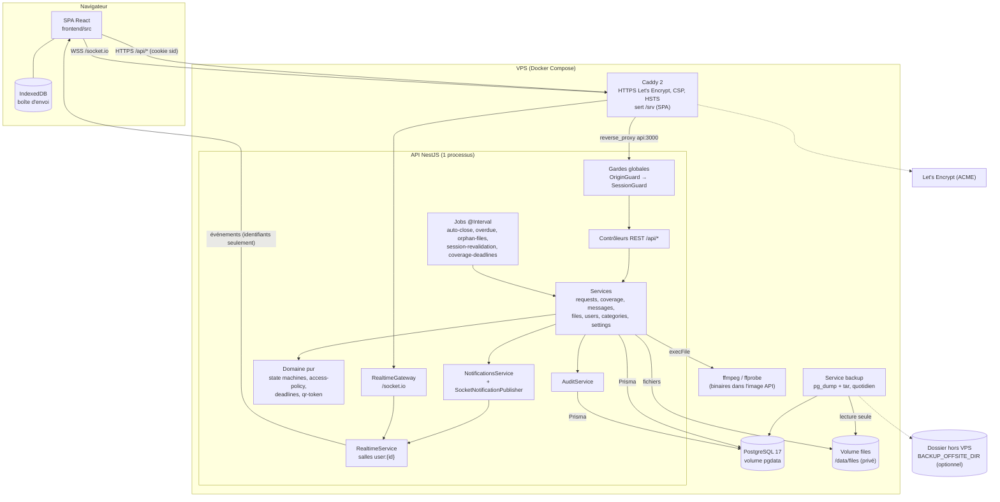
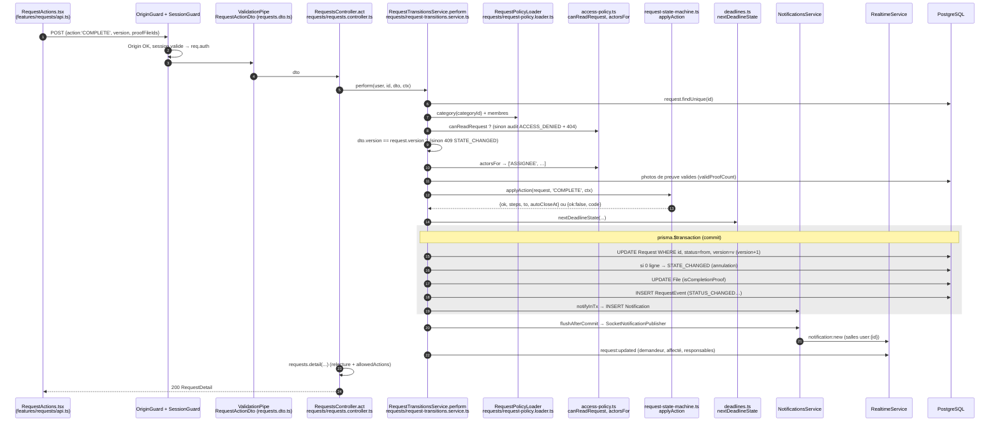
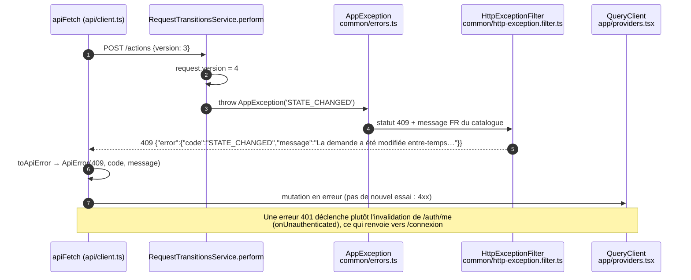

# Architecture — La Joconde Jumelle

> Analyse établie le 2026-10-15 à partir du code de la branche `002-refonte-ui-destinataires`
> (dernier commit `595c3fc`), y compris trois modifications **non commitées** (port 3000 → 3002,
> voir §9 et §10).
>
> Chaque affirmation est marquée :
> - **[VÉRIFIÉ]** : lue dans le code ou la configuration, ou constatée en exécutant une commande ;
> - **[DÉDUIT]** : supposition ou interprétation, non prouvée par le code.
>
> Les chemins sont relatifs à la racine du dépôt.

---

## 1. Vue d'ensemble

### Type d'application

- **[VÉRIFIÉ]** L'application est un **monolithe modulaire** en deux parties :
  - une **SPA React** (frontend) ;
  - une **API NestJS unique**, qui sert à la fois le REST sous `/api` et Socket.IO sous `/socket.io`.

  Le tout est exécuté dans **un seul processus API**. Sources : `backend/src/app.setup.ts` (`configureApp`, `setGlobalPrefix('api')`) et `backend/src/realtime/realtime.gateway.ts` (`@WebSocketGateway({ path: '/socket.io' })`).
- **[VÉRIFIÉ]** C'est un dépôt npm *workspaces* qui contient `backend` et `frontend` (`package.json`, champ `workspaces`).
- **[VÉRIFIÉ]** En production, Caddy sert la SPA en fichiers statiques et relaie `/api/*` et `/socket.io/*` vers l'API, **sur le même domaine** (`deploy/Caddyfile`).
- **[VÉRIFIÉ]** L'application couvre deux domaines métier qui partagent la table `Request` (champ `kind`) :
  - `WORK` : les demandes de travail (lot 1) ;
  - `COVERAGE` : la couverture de classe, c'est-à-dire la garde ou le remplacement (lot 2).

  Sources : `backend/prisma/schema.prisma` (`enum RequestKind`, `model Request.kind`).
- **[VÉRIFIÉ]** Il n'y a ni microservices, ni serverless, ni file de messages, ni cache externe (Redis absent des dépendances). L'absence de Redis est assumée dans `specs/001-demandes-travail-vocales/plan.md` (« Complexity Tracking »).

### Stack

Versions exactes lues dans `package-lock.json` ; Node vérifié avec `node -v` sur le poste.

| Couche | Technologie | Version | Source |
|---|---|---|---|
| Langage | TypeScript (strict) | 5.9.3 | `package.json`, `backend/tsconfig.json` |
| Runtime | Node.js | ≥ 24 exigé (24.21.0 sur le poste) | `package.json` (`engines`), `.nvmrc` |
| Framework API | NestJS (Express) | 11.2.7 | `backend/package.json` |
| Temps réel | Socket.IO (serveur et client) | 4.8.4 | `backend/package.json`, `frontend/package.json` |
| ORM | Prisma | 6.19.3 | `backend/package.json`, `backend/prisma/schema.prisma` |
| Base de données | PostgreSQL 17 | image `postgres:17` en prod ; `embedded-postgres` 17.10.0-beta.17 en dev | `deploy/docker-compose.yml`, `backend/scripts/dev-db.ts` |
| Validation | class-validator / class-transformer | 0.15 / 0.5 | `backend/src/common/validation.pipe.ts` |
| Mots de passe | argon2 (Argon2id) | 0.45.1 | `backend/src/auth/auth.service.ts` |
| Photos | sharp | 0.35.5 | `backend/src/files/photo-processing.ts` |
| Vocaux | ffmpeg / ffprobe (binaires système) | non figée | `backend/src/files/voice-processing.ts`, `deploy/api.Dockerfile` |
| Envoi de fichiers | Multer | 2.x | `backend/src/files/files.controller.ts` |
| Tâches planifiées | @nestjs/schedule (`@Interval`) | 6.x | `backend/src/scheduler/*.job.ts` |
| Limitation de débit | @nestjs/throttler | 6.x | `backend/src/auth/login-throttler.guard.ts` |
| UI | React | 19.3.0 | `frontend/package.json` |
| Build front | Vite | 8.3.4 | `frontend/vite.config.ts` |
| Routage front | React Router | 7.18.4 | `frontend/src/app/routes.tsx` |
| État serveur (front) | TanStack Query | 5.104.2 | `frontend/src/app/providers.tsx` |
| Composants | MUI (Material UI) + Emotion | 9.5.0 | `frontend/src/app/theme.tsx` |
| Icônes | lucide-react | 1.x | `frontend/src/app/providers.tsx` (`LucideProvider`) |
| Stockage local (front) | idb-keyval (IndexedDB) | 6.x | `frontend/src/features/outbox/outbox.ts` |
| Tests | Jest 30.5.2 + Supertest ; Vitest 5.0.4 + Testing Library ; Playwright 1.64.0 + axe | — | `package.json` des trois niveaux |
| Déploiement | Docker Compose, Caddy 2 | — | `deploy/` |

---

## 2. Rôle de chaque dossier et module

### Racine

| Dossier | Rôle | Source |
|---|---|---|
| `backend/` | API NestJS, schéma et migrations Prisma, scripts d'exploitation | [VÉRIFIÉ] |
| `frontend/` | SPA React | [VÉRIFIÉ] |
| `e2e/` | Tests de bout en bout Playwright : 12 fichiers `*.spec.ts`, profils navigateur, contrôles axe | [VÉRIFIÉ] `e2e/playwright.config.ts` |
| `deploy/` | Dockerfiles, docker-compose (prod et dev), Caddyfile, scripts de sauvegarde et de restauration | [VÉRIFIÉ] |
| `specs/001-demandes-travail-vocales/` | Spécification, plan, recherche, modèle de données, contrats et tâches du **lot 1** | [VÉRIFIÉ] |
| `docs/` | Validation manuelle (iPhone, utilisabilité) et procédure de la migration 0002 | [VÉRIFIÉ] |
| `.specify/`, `.claude/skills/` | Outillage « spec-kit » (modèles, constitution, commandes de l'assistant) ; pas du code applicatif | [VÉRIFIÉ] |

- **[VÉRIFIÉ]** Il n'existe **aucun dossier `specs/002-…`** : le lot 2 (couverture de classe) n'a pas de spécification versionnée. Il est seulement documenté par `docs/coverage-migration.md` et par les commentaires du code.

### Modules backend (`backend/src/`)

Les colonnes « Dépend de » et « Utilisé par » ont été établies à partir des `import '../<module>/…'` réels (commande `grep` sur `backend/src`). **[VÉRIFIÉ]**

| Module | Rôle | Dépend de | Utilisé par |
|---|---|---|---|
| `config/` | Lit et valide les variables d'environnement au démarrage (`loadConfig`) ; charge `backend/.env` hors production (`loadEnvFile`) ; fournit `APP_CONFIG` (module global) | — | auth, coverage, files, realtime, scheduler |
| `common/` | Prisma (`PrismaService`), catalogue d'erreurs (`AppException`, `ERROR_CATALOG`), filtre d'erreurs, pipe de validation, logger JSON, pagination par curseur, `SuperAdminGuard`, en-tête `X-Server-Time` | audit, auth | presque tous |
| `audit/` | Journal d'audit en ajout seul (`AuditService.log`, `sanitizeAuditDetails`) ; consultation `/api/admin/audit` (super administrateur) | common | auth, categories, common, coverage, files, messages, realtime, requests, settings, users |
| `auth/` | Connexion, déconnexion, changement de mot de passe (`AuthController`, `AuthService`) ; sessions serveur (`SessionService`) ; gardes globales `OriginGuard` (CSRF) et `SessionGuard` ; limitation des tentatives de connexion | audit, common, config, realtime, requests (`access-policy`), settings | presque tous (types `AuthenticatedUser`, décorateurs `@CurrentUser`, `@Public`) |
| `settings/` | Réglages globaux en base avec valeurs par défaut (`SETTING_DEFAULTS`), permissions par rôle, administration | audit, auth, common, users | auth, cli, coverage, files, messages, requests |
| `users/` | Administration des comptes (`/api/admin/users`) | audit, auth, common, realtime | categories, settings |
| `categories/` | Catégories visibles par l'utilisateur et leur administration (circuit, destinataires, responsables, délais par priorité) | audit, auth, common, requests, users | — |
| `requests/` | Demandes de travail. Contient deux modules **purs** : `domain/request-state-machine.ts` et `domain/access-policy.ts`, ainsi que `domain/deadlines.ts` et `domain/visibility.ts`. S'y ajoutent les services `RequestsService` (création, lecture, priorité, brouillons) et `RequestTransitionsService` (actions de statut) | audit, auth, common, files, notifications, realtime, settings | auth, categories, coverage, files, messages, scheduler |
| `messages/` | Fil de discussion d'une demande (texte, vocal, pièces jointes) | audit, auth, common, notifications, realtime, requests, settings | — |
| `files/` | Envoi, contrôle (octets magiques, ffprobe, sharp), stockage privé sur disque (`FileStorageService`) et lecture authentifiée (`GET /api/files/:id`) | audit, auth, common, config, coverage, requests, settings | requests, scheduler |
| `notifications/` | Écrit les notifications dans la transaction (`notifyInTx`) puis les publie après validation (`flushAfterCommit` → `SocketNotificationPublisher`) ; API de lecture | auth, common, realtime | coverage, messages, requests, scheduler |
| `realtime/` | `RealtimeService` (émission vers les salles `user:{id}` et `session:{id}`) ; `RealtimeGateway` (authentification à la poignée de main) | audit, auth, config | auth, coverage, messages, notifications, requests, scheduler, users |
| `scheduler/` | Tâches périodiques : clôture automatique, retards, revalidation des sessions WebSocket, fichiers orphelins | common, config, files, notifications, realtime, requests | coverage (constante `JOB_INTERVAL_MS`) |
| `coverage/` | Lot 2 : couverture de classe, avec sa propre machine à états (`domain/coverage-state-machine.ts`), sa politique d'accès (`domain/coverage-policy.ts`), le jeton QR signé (`domain/qr-token.ts`), la disponibilité des employés, les groupes, les classes, et sa propre tâche de délais (`coverage-deadlines.job.ts`) | audit, auth, common, config, notifications, realtime, requests, scheduler, settings | files |
| `health/` | `GET /api/health`, public, utilisé par le `HEALTHCHECK` Docker | auth (`@Public`) | Docker |
| `cli/` | `bootstrap.ts` : création du premier super administrateur en production | settings | exploitation |

Scripts et données hors `src/` :

| Dossier | Rôle |
|---|---|
| `backend/prisma/` | `schema.prisma`, migrations `0001_init` et `0002_coverage` (avec `down.sql`), `seed.ts` (données de démonstration), `seed-volume.ts` (volume de test) |
| `backend/scripts/` | Base de dev embarquée (`dev-db.ts`), serveur e2e, génération de fixtures, et trois scripts de maintenance ponctuels : `repair-employee-recipients.ts`, `check-users.ts`, `reset-superadmin-password.ts` |
| `backend/test/` | 15 fichiers de tests unitaires, 24 d'intégration (base PostgreSQL réelle), fixtures audio, image et PDF |

### Modules frontend (`frontend/src/`)

| Dossier | Rôle | Dépend de | Utilisé par |
|---|---|---|---|
| `api/` | `client.ts` (`apiFetch`, `ApiError`, `serverNow`), types partagés **écrits à la main** (`types.ts`), réglages, envois | — | toutes les features |
| `app/` | Point d'assemblage : providers (`QueryClient`, thème, toasts), routes, `AppLayout` (monte `SocketProvider`), thème MUI | api, components, design, features | `main.tsx` |
| `components/` | Composants génériques : badges, états vide, erreur et chargement, dialogues, comptes à rebours | design | features |
| `design/` | Jetons de design (`tokens.ts`) | — | app, components |
| `features/auth` | Connexion, changement de mot de passe, `RequireAuth`, `useCurrentUser` | api | app, autres features |
| `features/requests` | Liste, création, détail, actions, filtres et historique des demandes de travail | api, thread, voice, outbox | app |
| `features/thread` | Fil de discussion et pièces jointes | api, voice, outbox | requests |
| `features/voice` | Enregistrement et lecture des vocaux (MediaRecorder) | api | requests, thread |
| `features/outbox` | Boîte d'envoi locale (IndexedDB) des envois échoués | idb-keyval | requests, thread |
| `features/notifications` | `SocketProvider` (Socket.IO → invalidation du cache TanStack Query), centre de notifications | api, requests, thread | app |
| `features/coverage` | Écrans du lot 2 : gardes, création, présence (QR et photo), tableau de bord, administration des classes et des groupes | api | app |
| `features/admin` | Administration : comptes, catégories, réglages, journal d'audit | api | app |

- **[VÉRIFIÉ]** Le décompte des imports entre dossiers `features/` a été obtenu par `grep`.
- **[DÉDUIT]** Le sens exact de chaque flèche n'a pas été vérifié fichier par fichier.

---

## 3. Schéma d'architecture globale

**[VÉRIFIÉ]** Sources : `deploy/docker-compose.yml`, `deploy/Caddyfile`, `backend/src/app.module.ts`, `frontend/vite.config.ts`.



Points vérifiés dans le code :

- **[VÉRIFIÉ]** L'API et la base **ne publient aucun port** (`expose` seulement, `deploy/docker-compose.yml`). Seul Caddy écoute sur 80 et 443.
- **[VÉRIFIÉ]** Les événements Socket.IO ne transportent que des identifiants et des métadonnées. Le client relit les données par REST (commentaire de `RealtimeService` ; `SocketProvider` appelle `invalidateQueries`).
- **[VÉRIFIÉ]** Aucune API tierce n'est appelée par l'application. Les seuls services externes sont Let's Encrypt, via Caddy, et l'éventuel dossier de sauvegarde distant.

---

## 4. Parcours d'une requête, de bout en bout

### 4.1 Connexion (`POST /api/auth/login`)

```mermaid
sequenceDiagram
  autonumber
  actor U as Utilisateur
  participant LP as LoginPage.tsx<br/>(useLogin, useCurrentUser.ts)
  participant AF as apiFetch<br/>api/client.ts
  participant C as Caddy<br/>deploy/Caddyfile
  participant OG as OriginGuard<br/>auth/origin.guard.ts
  participant SG as SessionGuard<br/>auth/session.guard.ts
  participant TG as LoginThrottlerGuard<br/>auth/login-throttler.guard.ts
  participant VP as ValidationPipe<br/>common/validation.pipe.ts
  participant AC as AuthController.login<br/>auth/auth.controller.ts
  participant AS as AuthService.login<br/>auth/auth.service.ts
  participant SS as SessionService.create<br/>auth/session.service.ts
  participant AU as AuditService.log<br/>audit/audit.service.ts
  participant DB as PostgreSQL

  U->>LP: identifiant + mot de passe
  LP->>AF: POST /api/auth/login {username, password}
  AF->>C: fetch (credentials: same-origin)
  C->>OG: reverse_proxy
  OG->>OG: en-tête Origin = APP_ORIGIN ?
  OG->>SG: OK
  SG->>SG: route @Public() → laisse passer
  SG->>TG: 
  TG->>TG: ≤ N tentatives / min pour (IP, identifiant)
  TG->>VP: 
  VP->>VP: LoginDto (liste blanche, longueurs)
  VP->>AC: dto valide
  AC->>AS: login(username, password, ip)
  AS->>DB: user.findUnique(username normalisé)
  AS->>AS: argon2.verify (haché factice si compte inconnu)
  alt échec
    AS->>AU: LOGIN_FAILURE (raison)
    AU->>DB: INSERT AuditLog
    AS-->>AC: AppException INVALID_CREDENTIALS (401)
  else succès
    AS->>SS: create(userId, ip)
    SS->>SS: jeton 256 bits ; id = HMAC-SHA256(jeton)
    SS->>DB: INSERT Session (expiresAt = sessionMaxHours)
    AS->>AU: LOGIN_SUCCESS
    AU->>DB: INSERT AuditLog
    AS->>DB: rolePermission.findMany (permissions du rôle)
    AC-->>AF: 200 {user} + Set-Cookie sid (HttpOnly, SameSite=Strict, Secure*)
  end
  AF-->>LP: Me
  LP->>LP: navigate('/mot-de-passe' si mustChangePassword, sinon page demandée)
```

- **[VÉRIFIÉ]** L'ordre des gardes globales (Origin, puis Session) est fixé dans `auth/auth.module.ts` (`APP_GUARD`, avec le commentaire « Ordre des gardes globales »).
- **[DÉDUIT]** Les gardes de route, comme `LoginThrottlerGuard`, s'exécutent après les gardes globales. C'est le comportement standard de NestJS ; je ne l'ai pas tracé à l'exécution.
- **[VÉRIFIÉ]** `Secure` est forcé en production ; en dev, il dépend de `COOKIE_SECURE` (`config/config.ts`, `cookieSecure`).

### 4.2 Écriture en base : action sur une demande (`POST /api/requests/:id/actions`)

Exemple : l'employé affecté passe la demande à « Terminée » (`COMPLETE`).



- **[VÉRIFIÉ]** Toutes ces étapes figurent dans `RequestTransitionsService.perform` et `commit` (`requests/request-transitions.service.ts`) et dans `RequestsController.act`.
- **[VÉRIFIÉ]** Les notifications ne sont émises qu'**après** la transaction (`notifications.service.ts`, commentaire de `flushAfterCommit`).

### 4.3 Cas d'erreur : conflit de version et format d'erreur unique



- **[VÉRIFIÉ]** `HttpExceptionFilter` transforme toute exception en `{ error: { code, message, details? } }`. Une erreur inconnue est journalisée, puis masquée en `INTERNAL_ERROR` (500).
- **[VÉRIFIÉ]** Le frontend ne relance pas les erreurs 4xx (`shouldRetry` dans `app/providers.tsx`).
- **[DÉDUIT]** L'affichage exact du conflit à l'écran (« la demande a été rechargée ») dépend de chaque composant ; je ne l'ai pas suivi dans `RequestActions.tsx`.

Autre cas d'erreur vérifié dans le code : une requête modifiante sans en-tête `Origin` correct passe par `OriginGuard.canActivate`, qui écrit `ACCESS_DENIED / ORIGIN_MISMATCH` dans l'audit et renvoie 403 `FORBIDDEN`. **[VÉRIFIÉ]**

---

## 5. Modèle de données

**[VÉRIFIÉ]** Source : `backend/prisma/schema.prisma`. Pour la lisibilité, le diagramme ne montre que les champs principaux.

```mermaid
erDiagram
  User ||--o{ Session : "a"
  User ||--o{ CategoryRecipient : "destinataire de"
  User ||--o{ CategoryManager : "responsable de"
  User ||--o{ Request : "demandeur (requesterId)"
  User ||--o{ Request : "affecté (assigneeId)"
  User ||--o{ Message : "auteur"
  User ||--o{ File : "uploader"
  User ||--o{ Notification : "reçoit"
  User ||--o{ AuditLog : "acteur"
  User ||--o{ RequestEvent : "acteur"
  User ||--o{ EmployeeGroupMember : "membre"
  User ||--o{ CoveragePresence : "confirme"
  Category ||--o{ CategoryRecipient : ""
  Category ||--o{ CategoryManager : ""
  Category ||--o{ DeadlineRule : "délais par priorité"
  Category ||--o{ Request : "classe"
  Category }o--o| User : "autoAssignee"
  Request ||--o{ Message : "fil"
  Request ||--o{ File : "fichiers"
  Request |o--o| File : "voiceFile"
  Request ||--o{ RequestEvent : "historique (ajout seul)"
  Request ||--o{ Notification : ""
  Request ||--o| CoverageDetail : "si kind=COVERAGE"
  Message ||--o{ File : "pièces jointes"
  Message |o--o| File : "voiceFile"
  SchoolClass ||--o{ CoverageDetail : ""
  CoverageDetail ||--o{ CoverageTarget : "groupes ciblés"
  EmployeeGroup ||--o{ CoverageTarget : ""
  EmployeeGroup ||--o{ EmployeeGroupMember : ""
  Request ||--o{ CoveragePresence : ""
  CoveragePresence |o--o| File : "photo de présence"

  User { uuid id PK; string username UK; Role role; string passwordHash; bool mustChangePassword; bool active; Availability availability }
  Session { string id PK "HMAC du jeton"; uuid userId FK; datetime lastSeenAt; datetime expiresAt }
  RolePermission { Role role PK; Permission permission PK }
  Category { uuid id PK; string name UK; RequestKind kind; Circuit circuit; ClosureMode closureMode; bool finalValidation; AssignmentMode assignmentMode; bool photoRequired; ProofMode proofMode }
  DeadlineRule { uuid id PK; uuid categoryId FK; Priority priority; int validationMinutes; int takeoverMinutes; int completionMinutes; int arrivalMinutes }
  Setting { string key PK; json value }
  Request { uuid id PK; RequestKind kind; int number UK; string reference UK; uuid clientId; RequestStatus status; int version; json rulesSnapshot; Priority priority; DeadlineStage currentStage; datetime currentDueAt; datetime autoCloseAt }
  Message { uuid id PK; uuid requestId FK; MessageKind kind; string text; uuid clientId }
  File { uuid id PK; FileKind kind; string mimeType; string storagePath; bool isCompletionProof }
  RequestEvent { uuid id PK; uuid requestId FK; RequestEventType type; json fromValue; json toValue }
  AuditLog { uuid id PK; AuditAction action; uuid actorId; json details; string ip }
  Notification { uuid id PK; uuid userId FK; NotificationType type; uuid requestId FK; datetime readAt }
  SchoolClass { uuid id PK; string name UK; int qrVersion }
  EmployeeGroup { uuid id PK; string name UK }
  EmployeeGroupMember { uuid groupId PK; uuid userId PK }
  CoverageDetail { uuid requestId PK; uuid classId FK; datetime startAt; datetime plannedEndAt; uuid reliefForId }
  CoverageTarget { uuid requestId PK; uuid groupId PK }
  CoveragePresence { uuid id PK; uuid requestId FK; PresenceMethod method; uuid fileId }
```

Points clés :

- **[VÉRIFIÉ]** `Request.rulesSnapshot` (JSON) copie les règles de la catégorie à la création de la demande (`RequestPolicyLoader.rulesSnapshot`). Une modification ultérieure de la catégorie n'affecte donc pas les demandes en cours.
- **[VÉRIFIÉ]** `Request.version` sert au verrouillage optimiste (`updateMany … where version`).
- **[VÉRIFIÉ]** Le couple `(requesterId, clientId)` est unique, comme `(authorId, clientId)` sur `Message`. Cela rend les renvois idempotents depuis la boîte d'envoi (`RequestsService.create`, gestion de l'erreur `P2002`).
- **[VÉRIFIÉ]** `AuditLog` et `RequestEvent` sont protégées par des **triggers PostgreSQL** qui refusent `UPDATE`, `DELETE` et `TRUNCATE` (`backend/prisma/migrations/0001_init/migration.sql`, fonction `forbid_modification`).
- **[VÉRIFIÉ]** `RequestStatus` est un enum unique qui mélange les statuts du lot 1 et ceux du lot 2 (`BROADCAST`, `ON_DUTY`, etc.). C'est le code (`isCoverageStatus`, `kind`) qui les sépare, pas la base.

### Migrations

- **[VÉRIFIÉ]** Les migrations sont gérées par Prisma Migrate, dans `backend/prisma/migrations/` :
  - `0001_init` : schéma initial et triggers d'ajout seul ;
  - `0002_coverage` : lot 2, migration additive, accompagnée d'un `down.sql` manuel.
- **[VÉRIFIÉ]** En dev : `npm run -w backend prisma:migrate` (`prisma migrate dev`).
- **[VÉRIFIÉ]** En prod : `prisma migrate deploy` est exécuté **à chaque démarrage du conteneur** (`deploy/api-entrypoint.sh`).
- **[VÉRIFIÉ]** La procédure de sauvegarde et de retour arrière du lot 2 est décrite dans `docs/coverage-migration.md`.

---

## 6. Choix techniques et justifications

**Origine des choix.** `specs/001-demandes-travail-vocales/research.md` (ligne 5) indique : « La pile technique a été imposée par le client. » **[VÉRIFIÉ]** (le texte est présent dans le dépôt).

Je ne peux pas vérifier **quels éléments précis** figuraient dans ta demande initiale : le message d'origine n'est pas versionné, et la spec ne cite que la description fonctionnelle. La colonne « Origine » ci-dessous reprend donc ce que disent les documents du dépôt. **À confirmer par toi.**

| Choix | Pourquoi (selon le dépôt) | Alternatives écartées (selon `research.md`) | Compromis | Origine |
|---|---|---|---|---|
| SPA React + API NestJS **sur le même domaine** | Cookies de session simples, pas de CORS, `<audio src="/api/files/…">` authentifié par cookie (R1) | Next.js (SSR inutile sans SEO) ; deux domaines (CORS, cookies inter-domaines) | + simplicité, sécurité ; − l'API et la SPA doivent être derrière le même proxy | « pile imposée » (R1, R12) [VÉRIFIÉ dans le texte] |
| PostgreSQL 17 + Prisma | Données relationnelles, triggers d'ajout seul, transactions (R6, R5) | Non détaillé pour la base | + typage généré, migrations versionnées ; − requêtes complexes moins naturelles en Prisma (les listes utilisent `visibleRequestsWhere`) [DÉDUIT] | « pile imposée » [VÉRIFIÉ dans le texte] |
| Sessions serveur en base + cookie `HttpOnly`, `SameSite=Strict` ; Argon2id | Révocation immédiate, même authentification pour REST et WebSocket, rien de sensible dans le navigateur (R7) | JWT en stockage local (vol par XSS, révocation difficile) ; SSO de l'école (non demandé) | + révocable, simple ; − une lecture en base à chaque requête (`SessionService.validate`), atténuée par un `lastSeenAt` rafraîchi au plus une fois par minute [VÉRIFIÉ] | Décidé dans le plan (R7) [VÉRIFIÉ] ; demande explicite : **inconnu** |
| Autorisation par fonctions pures (`access-policy.ts`) | Une seule politique testée par table de cas, appliquée au REST, aux fichiers et aux sockets (R8) | CASL (superflue pour 3 rôles) | + testable sans base ; − une politique **distincte** a dû être écrite pour le lot 2 (`coverage-policy.ts`) | Décidé dans le plan ; la « contrainte imposée n° 4 » du plan exige machine à états et droits testés d'abord [VÉRIFIÉ] |
| Machine à états maison (`request-state-machine.ts`) + verrouillage optimiste | Source de vérité unique, testable ; gère deux actions simultanées (R5) | XState (inutile pour ~20 transitions) ; `SELECT … FOR UPDATE` (verrou plus long) | + lisible, testée ; − deuxième machine séparée pour le lot 2 (`coverage-state-machine.ts`) | Décidé dans le plan [VÉRIFIÉ] |
| Socket.IO, avec des événements contenant des **identifiants seulement** | Pas de second chemin de contrôle d'accès ; notifications persistées, donc rien n'est perdu hors ligne (R9) | Diffuser les données complètes ; SSE (« pile imposée : Socket.IO ») | + sûr ; − un aller-retour REST après chaque événement | Socket.IO : « pile imposée » [VÉRIFIÉ dans le texte] |
| TanStack Query comme seul gestionnaire d'état serveur côté front ; pas de Redux ni Zustand | Cache, invalidation par événement temps réel | Non documenté | + peu de code d'état ; − l'état local est éparpillé dans des `useState` et deux contextes (`ToastContext`, `RealtimeContext`) [VÉRIFIÉ] | Listé dans le plan ; demande explicite : **inconnu** |
| MUI + Emotion | Composants accessibles | Non documenté | − impose `style-src 'unsafe-inline'` dans la CSP (commentaire de `deploy/Caddyfile`) [VÉRIFIÉ] | Listé dans le plan ; demande explicite : **inconnu** |
| ffmpeg : conversion de tous les vocaux en AAC/MP4 | Safari enregistre en MP4/AAC, Chrome et Firefox en WebM ou Ogg ; la lecture croisée n'est pas garantie (plan, « Complexity Tracking ») | Garder le format d'origine | + lecture partout ; − dépendance à un binaire système, conversion synchrone dans le processus API [DÉDUIT : non mesuré] | Décidé dans le plan [VÉRIFIÉ] |
| sharp | Suppression des métadonnées EXIF/GPS (RGPD) | Garder les photos telles quelles | + vie privée ; − dépendance native | Décidé dans le plan [VÉRIFIÉ] |
| Jobs `@Interval` dans le processus API, sans Redis ni file de messages | Un seul processus suffit à l'échelle d'une école (plan) | Redis (« à réévaluer si plusieurs instances ») | + simple ; − **interdit de lancer plusieurs instances de l'API** sans retravail (throttler, Socket.IO et jobs sont en mémoire) | Décidé dans le plan [VÉRIFIÉ] |
| embedded-postgres en dev | Le poste n'avait ni Docker ni PostgreSQL (plan, ajouté le 2026-10-12) | Exiger Docker Desktop | + démarrage sans Docker ; − version bêta (`17.10.0-beta.17`) [VÉRIFIÉ] | Décidé pendant l'implémentation [VÉRIFIÉ] |
| Docker Compose + Caddy sur un seul VPS | Pile imposée, une seule machine, restauration simple (R12) | Kubernetes, stockage objet, base gérée | + coût et exploitation faibles ; − pas de haute disponibilité | « pile imposée » [VÉRIFIÉ dans le texte] |

---

## 7. Patterns et conventions

### Patterns appliqués

| Pattern | Où | Statut |
|---|---|---|
| **Architecture en couches** : contrôleur → service → domaine pur → Prisma | `requests/` (controller → `RequestsService` / `RequestTransitionsService` → `domain/*` → `PrismaService`) ; même structure dans `coverage/` | [VÉRIFIÉ] |
| **Domaine pur, sans dépendance à la base** (« functional core, imperative shell ») | `requests/domain/*.ts`, `coverage/domain/*.ts` : n'importent que des types Prisma | [VÉRIFIÉ] |
| **Injection de dépendances** (conteneur NestJS) | Tous les services ; jetons `APP_CONFIG` et `NOTIFICATION_PUBLISHER` | [VÉRIFIÉ] |
| **Stratégie / port-adaptateur** pour la publication des notifications | interface `NotificationPublisher`, implémentation `SocketNotificationPublisher` (`notifications.module.ts`) | [VÉRIFIÉ] |
| **Écrire puis publier après validation** (proche du pattern « outbox ») | `notifyInTx` puis `flushAfterCommit` | [VÉRIFIÉ] |
| **Verrouillage optimiste** | `updateMany({ where: { id, status, version } })` dans `RequestTransitionsService.commit` et `RequestsService.changePriority` | [VÉRIFIÉ] |
| **Idempotence par `clientId`** | `RequestsService.create`, contraintes uniques Prisma | [VÉRIFIÉ] |
| **Sécurité par défaut** (fermé par défaut) | `SessionGuard` global + décorateur `@Public()` | [VÉRIFIÉ] |
| **Catalogue d'erreurs centralisé** | `common/errors.ts` (`ERROR_CATALOG`) + `HttpExceptionFilter` | [VÉRIFIÉ] |
| **Organisation par fonctionnalité** (« feature folders ») côté front | `frontend/src/features/*` (chacune avec son `api.ts` de hooks TanStack Query) | [VÉRIFIÉ] |
| **Pas de pattern Repository** : les services appellent Prisma directement | tous les `*.service.ts` | [VÉRIFIÉ] |
| Mappers DTO → réponse | `requests.mapper.ts`, `messages.mapper.ts`, `coverage.mapper.ts` | [VÉRIFIÉ] |

### Incohérences constatées

1. **[VÉRIFIÉ]** **Affectation automatique hors snapshot.** `assignmentMode` est copié dans `rulesSnapshot` (`request-policy.loader.ts`), mais `RequestTransitionsService.assigneeContext` lit `category.assignmentMode` et `category.autoAssigneeId`, c'est-à-dire la catégorie **actuelle**, lors d'un `APPROVE`. Cela contredit le principe du snapshot (FR-022).
   **[DÉDUIT]** Si l'administrateur change le mode d'affectation entre la soumission et l'approbation, c'est la nouvelle règle qui s'applique.
2. **[VÉRIFIÉ]** **`RequestPolicyLoader` déclaré dans 5 modules** (`requests`, `categories`, `messages`, `files`, `coverage`) au lieu d'être exporté une seule fois. NestJS crée donc une instance par module. Le service est sans état, donc l'impact est **[DÉDUIT]** faible ; c'est surtout une duplication de déclaration.
3. **[VÉRIFIÉ]** **Job de délais du lot 2 rangé hors de `scheduler/`** (`coverage/coverage-deadlines.job.ts`), alors qu'il importe `JOB_INTERVAL_MS` depuis `scheduler/auto-close.job.ts`.
4. **[VÉRIFIÉ]** **Commentaire périmé** dans `notifications/notifications.service.ts` : « Implémentation sans effet en Phase 2 ; remplacée par Socket.IO en US4 ». `NoopNotificationPublisher` est exporté mais n'est utilisé nulle part, ni dans `src` ni dans `test` (`grep`).
5. **[VÉRIFIÉ]** **Types frontend écrits à la main.** `frontend/src/api/types.ts` annonce leur remplacement par des types générés (`api:types` → `src/api/schema.d.ts`), mais `schema.d.ts` n'existe pas et n'est importé nulle part. Les enums (`RequestStatus`, etc.) sont donc dupliqués entre le backend et le frontend.
6. **[VÉRIFIÉ]** **Dépendance inutilisée** : `@mui/icons-material` est déclarée dans `frontend/package.json`, mais aucun fichier de `frontend/src` ne l'importe. Les icônes viennent de `lucide-react` (49 fichiers).
7. **[VÉRIFIÉ]** **Style non uniforme** : `backend/scripts/check-users.ts` et `reset-superadmin-password.ts` utilisent des guillemets doubles, alors que `.prettierrc` impose `singleQuote: true`.
8. **[VÉRIFIÉ]** **Port incohérent**, voir §9 : 3002 dans `main.ts`, `config.ts`, `vite.config.ts` et `start.bat` ; 3000 dans `backend/.env.example`, le README, `deploy/Caddyfile.dev`, `api.Dockerfile`, `docker-compose.yml` et le test `config.spec.ts`.
9. **[VÉRIFIÉ]** **Script `dev` racine.** `npm run dev` lance `npm run -w backend start` (`node dist/main.js`), donc **le build déjà compilé** : pas de rechargement, et il faut avoir lancé `build` avant. Le README, lui, recommande `start:dev`.

---

## 8. Gestion transverse

### Configuration et variables d'environnement

- **[VÉRIFIÉ]** Les variables sont validées au démarrage par `loadConfig` (`backend/src/config/config.ts`) :
  - obligatoires : `DATABASE_URL`, `SESSION_SECRET` (≥ 32 caractères), `FILES_DIR`, `APP_ORIGIN` (URL valide) ;
  - facultatives : `PORT`, `FFMPEG_PATH`, `FFPROBE_PATH`, `COOKIE_SECURE`, `LOGIN_RATE_LIMIT` (ignorée en production), `JOBS_ENABLED`, `NODE_ENV`.

  L'API refuse de démarrer si une variable obligatoire est invalide (`ConfigError`).
- **[VÉRIFIÉ]** `TRUST_PROXY` est lue **directement** dans `app.setup.ts` (`process.env.TRUST_PROXY`), sans passer par `loadConfig`. `PORT` est également relue directement dans `main.ts`.
- **[VÉRIFIÉ]** `backend/.env` n'est chargé qu'hors production (`loadEnvFile`) et n'écrase pas les variables déjà définies. `.env` est ignoré par git (`.gitignore`, vérifié avec `git check-ignore`).
- **[VÉRIFIÉ]** Les réglages **métier** (taille des vocaux, délais, durée de session…) sont en base (`Setting`). Les valeurs par défaut sont dans `SETTING_DEFAULTS` et les bornes dans `SETTING_RULES` (`settings/settings.service.ts`).
- **[VÉRIFIÉ]** En production, les variables viennent de `deploy/.env` via `docker-compose.yml`, qui utilise la syntaxe `${VAR:?…}` pour bloquer le démarrage si un secret manque.

### Authentification et autorisation

- **[VÉRIFIÉ]** **Authentification** :
  - identifiant et mot de passe, Argon2id ;
  - comparaison en temps constant contre un haché factice si le compte est inconnu (`DUMMY_HASH_PROMISE`, `auth.service.ts`) ;
  - session serveur : seul le HMAC du jeton est stocké ;
  - expiration après inactivité (`sessionIdleMinutes`, 60 par défaut) et durée maximale (`sessionMaxHours`, 12) ;
  - mot de passe provisoire à changer obligatoirement (`mustChangePassword`, contrôlé dans `SessionGuard`) ;
  - 12 caractères minimum pour un nouveau mot de passe (`ChangePasswordDto`).
- **[VÉRIFIÉ]** **CSRF** : `OriginGuard` sur toutes les méthodes autres que GET, HEAD et OPTIONS, en complément de `SameSite=Strict`.
- **[VÉRIFIÉ]** **Limitation de débit** : 5 tentatives par minute et par couple (IP, identifiant), uniquement sur `/auth/login` (`LoginThrottlerGuard`). Stockage en mémoire, par défaut de `@nestjs/throttler`.
- **[VÉRIFIÉ]** **WebSocket** : mêmes contrôles (Origin, cookie, `mustChangePassword`) dans `RealtimeGateway.authenticate`. Les sessions expirées sont fermées toutes les 60 s (`SessionRevalidationJob` → `RealtimeService.revalidateSessions`).
- **[VÉRIFIÉ]** **Autorisation**, sur trois niveaux :
  1. le rôle global : `/admin/*` est réservé au super administrateur par `SuperAdminGuard` ;
  2. les permissions configurables par rôle (`RolePermission`, défauts dans `settings/default-permissions.ts`) ;
  3. la relation avec la demande : `actorsFor` → `REQUESTER`, `ASSIGNEE` ou `MANAGER`.

  Une ressource non visible donne un 404 avec audit `ACCESS_DENIED`.

### Gestion des erreurs et logs

- **[VÉRIFIÉ]** Les erreurs ont un format unique `{ error: { code, message, details } }` (`HttpExceptionFilter`). Les messages sont en français, dans `ERROR_CATALOG`. Les erreurs de validation renvoient la liste des champs (`createValidationPipe`, `flatten`).
- **[VÉRIFIÉ]** Les logs sortent en JSON, une ligne par entrée, sur stdout et stderr (`AppLogger`, `common/app-logger.ts`). Les secrets sont masqués par motifs (argon2, cookie, token, password…). **Aucune requête HTTP n'est journalisée** (commentaire de la classe ; aucun middleware de log dans `configureApp`).
- **[VÉRIFIÉ]** Le journal d'audit filtre les champs de `details` par liste blanche et retire les clés sensibles (`sanitizeAuditDetails`).
- **[VÉRIFIÉ]** Côté front, `ApiError` porte le statut et le code. Une erreur 401 invalide `/auth/me`, ce qui renvoie vers la connexion (`createQueryClient`).
- **[DÉDUIT]** Il n'y a ni outil de suivi d'erreurs (Sentry ou équivalent) ni métriques : aucune dépendance de ce type n'apparaît dans les `package.json`.

### Intégrations externes

- **[VÉRIFIÉ]** **Aucune API tierce** n'est appelée par le code applicatif (pas de client HTTP sortant dans `backend/src`). Pas d'e-mail, pas de notifications push (contrainte du plan).
- **[VÉRIFIÉ]** Les dépendances externes à l'exécution sont :
  - les binaires `ffmpeg` et `ffprobe`, appelés par `execFile` (`files/voice-processing.ts`) ;
  - Let's Encrypt, via Caddy (`deploy/Caddyfile`) ;
  - le registre npm et Docker Hub, au moment du build.

---

## 9. Déploiement et exécution

### En local

**[VÉRIFIÉ]** Commandes lues dans le README, les `package.json` et `start.bat` :

```bash
npm install
cp backend/.env.example backend/.env      # renseigner SESSION_SECRET
npm run -w backend db:dev                 # PostgreSQL embarqué, port 5433 (terminal dédié)
npm run -w backend prisma:migrate
npm run -w backend prisma:seed
npm run -w backend start:dev              # API avec rechargement
npm run -w frontend dev                   # Vite sur :5173, proxy /api et /socket.io
```

- **[VÉRIFIÉ]** `start.bat` (non commité) automatise ces étapes sous Windows :
  1. il démarre la base embarquée si le port 5433 est libre ;
  2. il refuse de continuer si le port 3002 est déjà occupé ;
  3. il lance `npm run dev`, qui exige un backend **déjà compilé** (voir §7, point 9).
- **[VÉRIFIÉ]** **Port de l'API en développement** : les modifications non commitées passent la valeur par défaut de 3000 à **3002** dans `main.ts`, `config.ts`, `vite.config.ts` et `frontend/package.json`. Mais :
  - `backend/.env.example` contient toujours `PORT=3000`, ce qui ramène l'API sur 3000 pour qui copie l'exemple, alors que Vite cherche 3002 ;
  - `deploy/Caddyfile.dev` relaie vers `host.docker.internal:3000`.
- **[VÉRIFIÉ]** **Le test `backend/test/unit/config.spec.ts` échoue** (attendu 3000, reçu 3002). Résultat exécuté : 348 tests passent sur 349.

### Build

- **[VÉRIFIÉ]** Backend : `npm run -w backend build` (`nest build` → `backend/dist`).
- **[VÉRIFIÉ]** Frontend : `npm run -w frontend build` (`tsc -b && vite build` → `frontend/dist`).
- **[VÉRIFIÉ]** Contrôle complet : `npm run verify` (lint, tests unitaires et d'intégration, `npm audit --audit-level=high`). E2E : `npm run test:e2e`.

### Déploiement (VPS)

**[VÉRIFIÉ]** Sources : `deploy/docker-compose.yml`, `api.Dockerfile`, `web.Dockerfile`, `api-entrypoint.sh`.

```bash
cp deploy/.env.example deploy/.env
docker compose -f deploy/docker-compose.yml --env-file deploy/.env up -d --build
docker compose -f deploy/docker-compose.yml --env-file deploy/.env exec api node dist/cli/bootstrap.js admin "Direction"
```

- **[VÉRIFIÉ]** Quatre services :
  - `caddy` : image construite avec la SPA ;
  - `api` : Node 24 + ffmpeg, utilisateur `node` non root, `HEALTHCHECK` sur `/api/health`, migrations appliquées au démarrage ;
  - `db` : `postgres:17` ;
  - `backup` : boucle quotidienne, `pg_dump` + `tar`, rotation sur 14 jours, copie hors du VPS seulement si `BACKUP_OFFSITE_DIR` est défini.
- **[VÉRIFIÉ]** Swagger (`/api/docs`) n'est exposé qu'en dehors de la production (`configureApp`).
- **[VÉRIFIÉ]** Il n'y a **pas de CI/CD** dans le dépôt (aucun dossier `.github/` ni équivalent dans l'arborescence).
- **[DÉDUIT]** Les déploiements sont donc manuels.

---

## 10. Faiblesses d'architecture

### Couplages et dépendances circulaires

- **[VÉRIFIÉ]** Il y a des **cycles d'import entre dossiers** (relevés avec `grep`) :
  - `requests ↔ files` : `requests.module` importe `FilesModule`, et `files.service` importe `requests/domain/access-policy` et `RequestPolicyLoader` ;
  - `auth ↔ requests` : `session.service` importe `permissionsFor` depuis `requests/domain/access-policy` ;
  - `common ↔ audit`, `common ↔ auth` : `SuperAdminGuard`, placé dans `common/`, dépend d'`AuditService` et de `auth/request-info`.

  Un cycle de modules NestJS a dû être contourné explicitement : `RealtimeGatewayModule` existe « pour éviter une dépendance circulaire avec AuthModule » (commentaire dans `realtime/realtime-gateway.module.ts`).
- **[VÉRIFIÉ]** Le module `files` dépend du domaine de `coverage` (`canReadPresenceProof`, `CoverageAccessLoader`). Le stockage de fichiers connaît donc la politique d'accès de **chaque** domaine métier.
  **[DÉDUIT]** Tout nouveau type de ressource avec fichiers obligera à modifier `files.service.ts`.
- **[VÉRIFIÉ]** Six modules sont `@Global()` : Config, Prisma, Audit, Settings, Notifications, Realtime.
  **[DÉDUIT]** C'est pratique, mais les dépendances réelles n'apparaissent plus dans les `imports` des modules ; le tableau du §2 a dû être reconstruit à partir des imports de fichiers.

### Responsabilités mal placées ou concentrées

- **[VÉRIFIÉ]** Certains services sont volumineux :
  - `coverage/coverage-actions.service.ts` : 750 lignes ;
  - `coverage/coverage.service.ts` : 557 lignes ;
  - `requests/requests.service.ts` : 491 lignes, avec 8 dépendances injectées.

  **[DÉDUIT]** Ce sont les zones les plus coûteuses à modifier et à relire.
- **[VÉRIFIÉ]** `access-policy.ts`, un module de domaine des demandes, porte aussi des règles transverses : `permissionsFor`, utilisée par l'authentification, `canManageAdministration` et `canReadAudit`.
- **[VÉRIFIÉ]** `TRUST_PROXY` et `PORT` sont lues en dehors de `loadConfig` (voir §8).

### Code dupliqué

- **[VÉRIFIÉ]** Il existe deux machines à états, deux politiques d'accès, deux calculs de délais et deux jobs de délais, un jeu pour chaque `kind` (`requests/domain/*` et `coverage/domain/*`). Le partage de la table `Request` n'a pas permis de mutualiser cette logique.
  **[DÉDUIT]** Une règle transverse (par exemple « un responsable peut toujours annuler ») devra être écrite deux fois.
- **[VÉRIFIÉ]** La fonction `originOf` est dupliquée dans `auth/origin.guard.ts` et `realtime/realtime.gateway.ts`.
- **[VÉRIFIÉ]** Les listes de clés sensibles sont dupliquées, avec des différences : `app-logger.ts` contient `authorization`, absent d'`audit.service.ts`, et `audit.service.ts` contient `^message$`, absent du logger.
- **[VÉRIFIÉ]** Les types du frontend dupliquent ceux du backend à la main (voir §7, point 5).

### Exploitation et évolutivité

- **[VÉRIFIÉ]** L'état en mémoire (throttler, adaptateur Socket.IO, drapeau `running` des jobs) **impose une seule instance** de l'API. C'est assumé dans le plan.
- **[VÉRIFIÉ]** **Aucune purge automatique** des données personnelles : `grep` ne trouve ni « retention » ni « purge » dans `backend/src`. Le README le confirme (« La suppression automatique à l'échéance n'est pas réalisée dans ce lot »).
- **[VÉRIFIÉ]** Les migrations s'appliquent automatiquement à chaque démarrage du conteneur (`api-entrypoint.sh`).
  **[DÉDUIT]** Une migration défectueuse empêcherait l'API de démarrer, sans étape de validation intermédiaire. `docs/coverage-migration.md` demande une sauvegarde manuelle avant, mais rien ne l'impose techniquement.
- **[VÉRIFIÉ]** Le script `backend/scripts/reset-superadmin-password.ts` modifie le mot de passe du super administrateur **sans entrée d'audit et sans révoquer ses sessions**, alors que `cli/bootstrap.ts` écrit dans `auditLog`. Il contourne donc le principe de traçabilité.
- **[VÉRIFIÉ]** `embedded-postgres` est en version bêta (`17.10.0-beta.17`), mais seulement pour le développement et les tests.

### Testabilité

- **[VÉRIFIÉ]** C'est un point fort : le domaine pur est testé sans base. Le dépôt compte 15 fichiers de tests unitaires backend, 24 d'intégration sur une vraie PostgreSQL, 17 fichiers frontend et 12 scénarios E2E.
- **[VÉRIFIÉ]** Résultats exécutés le 2026-10-15 :
  - backend unitaire : **348 réussis / 1 en échec** (`config.spec.ts`, port) ;
  - frontend : **120 / 120** réussis.
- **[DÉDUIT]** Les tests d'intégration et E2E n'ont **pas** été lancés pour ce document (voir §11).
- **[DÉDUIT]** Les services qui appellent Prisma directement, sans repository, ne se testent qu'avec une base réelle. C'est le choix fait ici (tests d'intégration), mais cela rend ces tests plus lents.

---

## 11. Ce que je dois vérifier moi-même

Points que je n'ai pas pu vérifier, ou qui demandent une décision :

1. **Origine des choix techniques.** Le dépôt dit « pile imposée par le client », sans liste précise. Confirme quels éléments (NestJS, Prisma, MUI, TanStack Query, Caddy…) venaient de ta demande et lesquels ont été proposés dans le plan.
2. **Port 3000 ou 3002.** Décide de la valeur, puis aligne `backend/.env.example`, le README, `deploy/Caddyfile.dev` et `test/unit/config.spec.ts`, ou annule les modifications non commitées. En l'état, un test échoue.
3. **Tests d'intégration et E2E.** Je ne les ai pas lancés (ils demandent la base embarquée et les navigateurs Playwright). À exécuter : `npm run -w backend test:integration` et `npm run test:e2e`.
4. **Lint.** `npm run lint` n'a pas été lancé. La vérification de types (`typecheck`) a été exécutée sur le backend et le frontend : aucune erreur. [VÉRIFIÉ]
5. **Lot 2 sans spécification.** Il n'y a pas de `specs/002-…`. Les règles de la couverture de classe (statuts, délais de 2 et 5 min, preuve QR et photo) ne sont documentées que dans le code et `docs/coverage-migration.md`. Elles doivent être validées par l'établissement.
6. **Affectation automatique en circuit B.** Elle lit la catégorie actuelle plutôt que le snapshot (§7, point 1). Est-ce voulu ?
7. **Script `reset-superadmin-password.ts`.** Non audité, et sessions non révoquées. Faut-il le garder, le corriger ou le supprimer ?
8. **Restauration des sauvegardes.** `deploy/backup/restore.sh` existe, mais je n'ai pas vérifié qu'il fonctionne. Le README exige de le tester avant la production.
9. **Performances.** Les objectifs du plan (notification < 5 s, recherche < 2 s sur 10 000 demandes) font l'objet de tests (`search-performance.spec.ts`, `sc001-create-timing.spec.ts`), mais je ne les ai pas exécutés.
10. **Décisions métier encore provisoires** (README, « À trancher ») : durées de conservation, permissions par rôle, délais, destinataires par catégorie, accusé de lecture.
11. **Validations manuelles** non faites selon le README : test sur un vrai iPhone (`docs/validation/iphone-manuel.md`) et test d'utilisabilité avec 5 employés.
12. **Sécurité en conditions réelles.** La CSP, HSTS et la limite de 26 Mo sont configurées dans `deploy/Caddyfile`, mais je n'ai pas vérifié leur comportement sur un déploiement réel.
